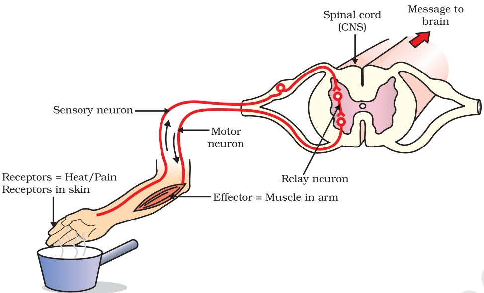

Figure 6.2 Reflex arc

**Can you now trace the sequence of events which occur when a bright light is focussed on your eyes?**

## 6.1.2 Human Brain

**Is reflex action the only function of the spinal cord? Obviously not, since we know that we are thinking beings. Spinal cord is made up of nerves which supply information to think about. Thinking involves more complex mechanisms and neural connections. These are concentrated in the brain, which is the main coordinating centre of the body. The brain and spinal cord constitute the central nervous system (Fig. 6.3). They receive information from all parts of the body and integrate it.**

**We also think about our actions. Writing, talking, moving a chair, clapping at the end of a programme are examples of voluntary actions which are based on deciding what to do next. So, the brain also has to send messages to muscles. This is the second way in which the nervous system communicates with the muscles. The communication between the central nervous system and the other parts of the body is facilitated by the peripheral nervous system consisting of cranial nerves arising from the brain and spinal nerves arising from the spinal cord. The brain thus allows us to think and take actions based on that thinking. As you will expect, this is accomplished through a complex design, with different parts of the brain responsible for integrating different inputs and outputs. The brain has three such major parts or regions, namely the fore-brain, mid-brain and hind-brain.**

**The fore-brain is the main thinking part of the brain. It has regions which receive sensory impulses from various receptors. Separate areas of the fore-brain are specialised for hearing, smell, sight and so on. There are separate areas of association where this sensory information is interpreted by putting it together with information from other receptors as well as with information that is already stored in the brain. Based on**