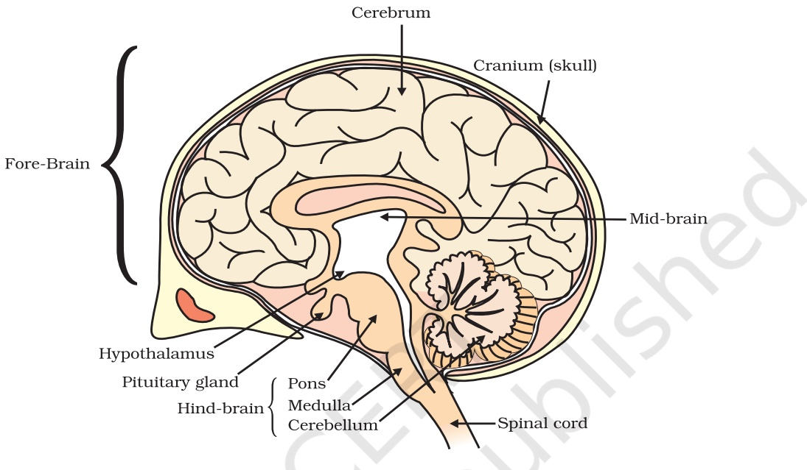

**all this, a decision is made about how to respond and the information is passed on to the motor areas which control the movement of voluntary muscles, for example, our leg muscles. However, certain sensations are distinct from seeing or hearing, for example, how do we know that we have eaten enough? The sensation of feeling full is because of a centre associated with hunger, which is in a separate part of the fore-brain.**

Figure 6.3 Human brain

**Study the labelled diagram of the human brain. We have seen that the different parts have specific functions. Can we find out the function of each part?**

**Let us look at the other use of the word ‘reflex’ that we have talked about in the introduction. Our mouth waters when we see food we like without our meaning to. Our hearts beat without our thinking about it. In fact, we cannot control these actions easily by thinking about them even if we wanted to. Do we have to think about or remember to breathe or digest food? So, in between the simple reflex actions like change in the size of the pupil, and the thought out actions such as moving a chair, there is another set of muscle movements over which we do not have any thinking control. Many of these involuntary actions are controlled by the mid-brain and hind-brain. All these involuntary actions including blood pressure, salivation and vomiting are controlled by the medulla in the hind-brain.**

**Think about activities like walking in a straight line, riding a bicycle, picking up a pencil. These are possible due to a part of the hind-brain called the cerebellum. It is responsible for precision of voluntary actions and maintaining the posture and balance of the body. Imagine what would happen if each of these events failed to take place if we were not thinking about it.**