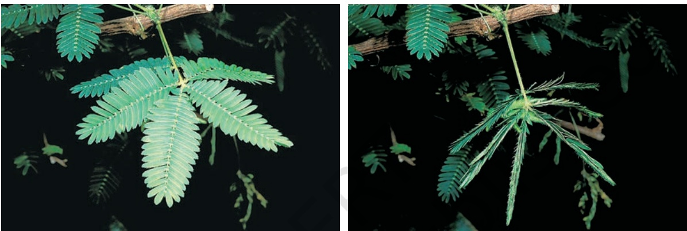

**There is no growth involved in this movement. On the other hand, the directional movement of a seedling is caused by growth. If it is prevented from growing, it will not show any movement. So plants show two different types of movement – one dependent on growth and the other independent of growth.**

## 6.2.1 Immediate Response to Stimulus

**Let us think about the first kind of movement, such as that of the sensitive plant. Since no growth is involved, the plant must actually move its leaves in response to touch. But there is no nervous tissue, nor any muscle tissue. How does the plant detect the touch, and how do the leaves move in response?**

Figure 6.4 The sensitive plant

**If we think about where exactly the plant is touched, and what part of the plant actually moves, it is apparent that movement happens at a point different from the point of touch. So, information that a touch has occurred must be communicated. The plants also use electrical-chemical means to convey this information from cell to cell, but unlike in animals, there is no specialised tissue in plants for the conduction of information. Finally, again as in animals, some cells must change shape in order for movement to happen. Instead of the specialised proteins found in animal muscle cells, plant cells change shape by changing the amount of water in them, resulting in swelling or shrinking, and therefore in changing shapes (Fig. 6.4).**

## 6.2.2 Movement Due to Growth

**Some plants like the pea plant climb up other plants or fences by means of tendrils. These tendrils are sensitive to touch. When they come in contact with any support, the part of the tendril in contact with the object does not grow as rapidly as the part of the tendril away from the object. This causes the tendril to circle around the object and thus cling to it. More commonly, plants respond to stimuli slowly by growing in a particular direction. Because this growth is directional, it appears as if the plant is moving. Let us understand this type of movement with the help of an example.**