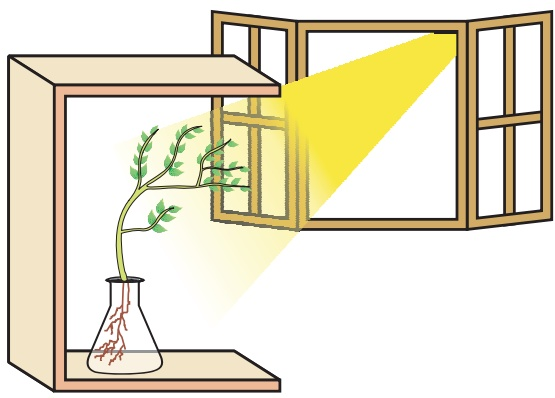
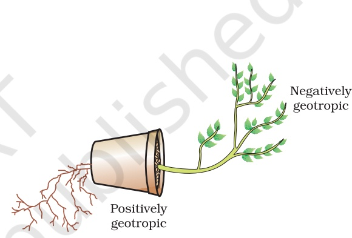

## Activity 6.2

n **Fill a conical flask with water.**

n **Cover the neck of the flask with a wire mesh.**

**Keep two or three freshly germinated bean seeds on the wire mesh.**

**Take a cardboard box which is open from one side.**

**Keep the flask in the box in such a manner that the open side of the box faces light coming from a window (Fig. 6.5).**

**After two or three days, you will notice that the shoots bend towards light and roots away from light.**

**Now turn the flask so that the shoots are away from light and the roots towards light. Leave it undisturbed in this condition for a few days.**

**Have the old parts of the shoot and root changed direction?**

**Are there differences in the direction of the new growth?**

**What can we conclude from this activity?**

**Environmental triggers such as light, or gravity will change the directions that plant parts grow in. These directional, or tropic, movements can be either towards the stimulus, or away from it. So, in two different kinds of phototropic movement, shoots respond by bending towards light while roots respond by bending away from it. How does this help the plant?**

Figure 6.5 Response of the plant to the direction of light

Figure 6.6 Plant showing geotropism

**Plants show tropism in response to other stimuli as well. The roots of a plant always grow downwards while the shoots usually grow upwards and away from the earth. This upward and downward growth of shoots and roots, respectively, in response to the pull of earth or gravity** is, obviously, geotropism (Fig. 6.6). If ‘hydro’ means water and ‘chemo **refers to chemicals, what would ‘hydrotropism’ and ‘chemotropism’ mean? Can we think of examples of these kinds of directional growth movements? One example of chemotropism is the growth of pollen tubes towards ovules, about which we will learn more when we examine the reproductive processes of living organisms.**

**Let us now once again think about how information is communicated in the bodies of multicellular organisms. The movement of the sensitive plant in response to touch is very quick. The movement of sunflowers in response to day or night, on the other hand, is quite slow. Growth-related movement of plants will be even slower.**

**Even in animal bodies, there are carefully controlled directions to growth. Our arms and fingers grow in certain directions, not haphazardly. So controlled movements can be either slow or fast. If fast responses to stimuli are to be made, information transfer must happen very quickly. For this, the medium of transmission must be able to move rapidly.**