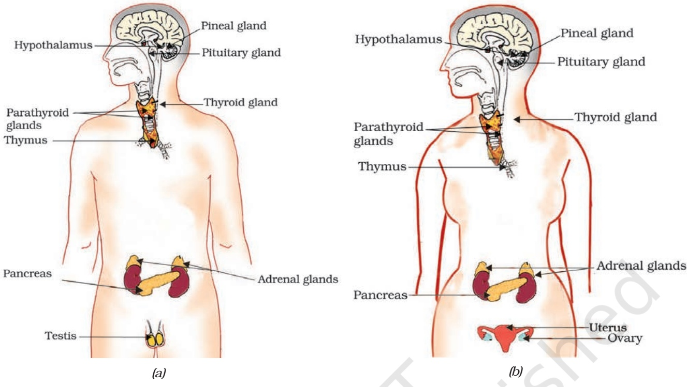

Figure 6.7 Endocrine glands in human beings (a) male, (b) female

## Do You Know?

**Let us examine some examples to understand how hormones help in coordinated growth. We have all seen salt packets which say ‘iodised salt’ or ‘enriched with iodine’. Why is it important for us to have iodised salt in our diet? Iodine is necessary for the thyroid gland to make thyroxin hormone. Thyroxin regulates carbohydrate, protein and fat metabolism in the body so as to provide the best balance for growth. Iodine is essential for the synthesis of thyroxin. In case iodine is deficient in our diet, there is a possibility that we might suffer from goitre. One of the symptoms in this disease is a swollen neck. Can you correlate this with the position of the thyroid gland in Fig. 6.7?**

**Hypothalamus plays an important role in the release of many hormones. For example, when the level of growth hormone is low, the hypothalamus releases growth hormone releasing factor which stimulates the pituitary gland to release growth hormone.**

**Sometimes we come across people who are either very short (dwarfs) or extremely tall (giants). Have you ever wondered how this happens? Growth hormone is one of the hormones secreted by the pituitary. As its name indicates, growth hormone regulates growth and development of the body. If there is a deficiency of this hormone in childhood, it leads to dwarfism.**

**You must have noticed many dramatic changes in your appearance as well as that of your friends as you approached 10–12 years of age. These changes associated with puberty are because of the secretion of testosterone in males and oestrogen in females.**

**Do you know anyone in your family or friends who has been advised by the doctor to take less sugar in their diet because they are suffering from diabetes? As a treatment, they might be taking injections of insulin. This is a hormone which is produced by the pancreas and helps in regulating blood sugar levels. If it is not secreted in proper amounts, the sugar level in the blood rises causing many harmful effects.**