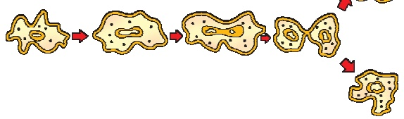
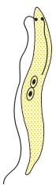
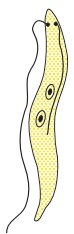
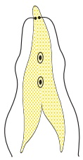
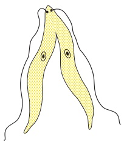

# 7.2 MODES OF REPRODUCTION USED BY SINGLE ORGANISMS

## Activity 7.1

n **Dissolve about 10 gm of sugar in 100 mL of water.**

**Take 20 mL of this solution in a test tube and add a pinch of yeast granules to it.**

**Put a cotton plug on the mouth of the test tube and keep it in a warm place.**

**After 1 or 2 hours, put a small drop of yeast culture from the test tube on a slide and cover it with a coverslip.**

n **Observe the slide under a microscope.**

## Activity 7.2

**Wet a slice of bread, and keep it in a cool, moist and dark place.**

n **Observe the surface of the slice with a magnifying glass.**

n **Record your observations for a week.**

**Compare and contrast the ways in which yeast grows in the first case, and how mould grows in the second.**

**Having discussed the context in which reproductive processes work, let us now examine how different organisms actually reproduce. The modes by which various organisms reproduce depend on the body design of the organisms.**

## 7.2.1 Fission

**For unicellular organisms, cell division, or fission, leads to the creation of new individuals. Many different patterns of fission have been observed. Many bacteria and protozoa simply split into two equal halves during cell division. In organisms such as Amoeba, the splitting of the two cells during division can take place in any plane.**

## Activity 7.3

**Observe a permanent slide of Amoeba under a microscope.**

**Similarly observe another permanent slide of Amoeba showing binary fission.**

**Now, compare the observations of both the slides.**

**However, some unicellular organisms show somewhat more organisation of their bodies, such as is seen in Leishmania (which cause kala-azar), which have a whip-like structure at one end of the cell. In such**

**Figure 7.1(a) Binary fission in Amoeba**

(c)

(d)

(e)

Figure 7.1(b) Binary fission in Leishmania

**organisms, binary fission occurs in a definite orientation in relation to**