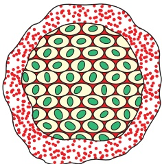

Figure 7.2 Multiple fission in Plasmodium

**these structures. Other single-celled organisms, such as the malarial parasite, Plasmodium, divide into many daughter cells simultaneously by multiple fission.**

**Yeast, on the other hand, can put out small buds that separate and grow further, as we saw in Activity 7.1.**

## 7.2.2 Fragmentation

## Activity 7.4

**Collect water from a lake or pond that appears dark green and contains filamentous structures.**

n **Put one or two filaments on a slide.**

n **Put a drop of glycerine on these filaments and cover it with a coverslip.**

n **Observe the slide under a microscope.**

n **Can you identify different tissues in the Spirogyra filaments?**

**In multi-cellular organisms with relatively simple body organisation, simple reproductive methods can still work. Spirogyra, for example, simply breaks up into smaller pieces upon maturation. These pieces or fragments grow into new individuals. Can we work out the reason for this, based on what we saw in Activity 7.4?**

**This is not true for all multi-cellular organisms. They cannot simply divide cell-by-cell. The reason is that many multi-cellular organisms, as we have seen, are not simply a random collection of cells. Specialised cells are organised as tissues, and tissues are organised into organs, which then have to be placed at definite positions in the body. In such a carefully organised situation, cell-by-cell division would be impractical. Multi-cellular organisms, therefore, need to use more complex ways of reproduction.**

**A basic strategy used in multi-cellular organisms is that different cell types perform different specialised functions. Following this general pattern, reproduction in such organisms is also the function of a specific cell type. How is reproduction to be achieved from a single cell type, if the organism itself consists of many cell types? The answer is that there must be a single cell type in the organism that is capable of growing, proliferating and making other cell types under the right circumstances.**

## 7.2.3 Regeneration

**Many fully differentiated organisms have the ability to give rise to new individual organisms from their body parts. That is, if the individual is somehow cut or broken up into many pieces, many of these pieces grow into separate individuals. For example, simple animals like Hydra and Planaria can be cut into any number of pieces and each piece grows into a complete organism. This is known as regeneration (see Fig. 7.3). Regeneration is carried out by specialised cells. These cells proliferate and make large numbers of cells. From this mass of cells, different cells undergo changes to become various cell types and tissues. These changes**