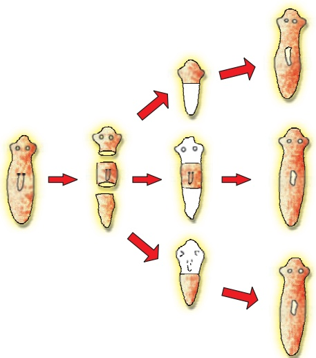
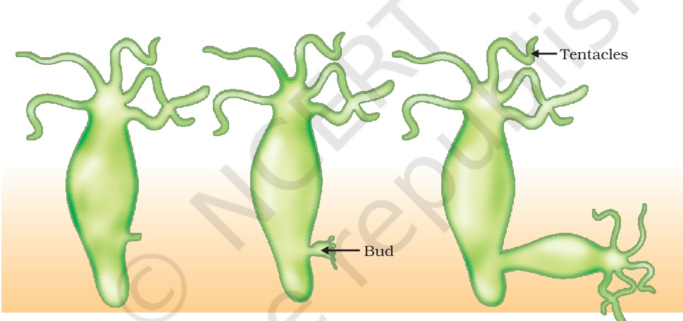

Figure 7.3 Regeneration in Planaria

**take place in an organised sequence referred to as development. However, regeneration is not the same as reproduction, since most organisms would not normally depend on being cut up to be able to reproduce.**

## 7.2.4 Budding

**Organisms such as Hydra use regenerative cells for reproduction in the process of budding. In Hydra, a bud develops as an outgrowth due to repeated cell division at one**

**specific site (Fig. 7.4). These buds develop into tiny individuals and when fully mature, detach from the parent body and become new independent individuals.**

Figure 7.4 Budding in Hydra

## 7.2.5 Vegetative Propagation

**There are many plants in which parts like the root, stem and leaves develop into new plants under appropriate conditions. Unlike in most animals, plants can indeed use such a mode for reproduction. This property of vegetative propagation is used in methods such as layering or grafting to grow many plants like sugarcane, roses, or grapes for agricultural purposes. Plants raised by vegetative propagation can bear flowers and fruits earlier than those produced from seeds. Such methods also make possible the propagation of plants such as banana, orange, rose and jasmine that have lost the capacity to produce seeds. Another advantage of vegetative propagation is that all plants produced are genetically similar enough to the parent plant to have all its characteristics.**