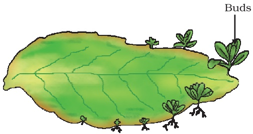
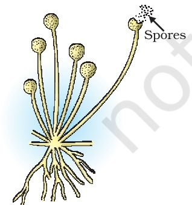

## Activity 7.5

n **Take a potato and observe its surface. Can notches be seen?**

**Cut the potato into small pieces such that some pieces contain a notch or bud and some do not.**

**Spread some cotton on a tray and wet it. Place the potato pieces on this cotton. Note where the pieces with the buds are placed.**

**Observe changes taking place in these potato pieces over the next few days. Make sure that the cotton is kept moistened.**

Figure 7.5

Leaf of Bryophyllum

with buds

**Which are the potato pieces that give rise to fresh green shoots and roots?**

**Similarly buds produced in the notches along the leaf margin of Bryophyllum fall on the soil and develop into new plants (Fig. 7.5).**

## Activity 7.6

n **Select a money-plant.**

**Cut some pieces such that they contain at least one leaf.**

n **Cut out some other portions between two leaves.**

**Dip one end of all the pieces in water and observe over the next few days.**

n **Which ones grow and give rise to fresh leaves?**

n **What can you conclude from your observations?**

## Tissue culture

**In tissue culture, new plants are grown by removing tissue or separating cells from the growing tip of a plant. The cells are then placed in an artificial medium where they divide rapidly to form a small group of cells or callus. The callus is transferred to another medium containing hormones for growth and differentiation. The plantlets are then placed in the soil so that they can grow into mature plants. Using tissue culture, many plants can be grown from one parent in disease-free conditions. This technique is commonly used for ornamental plants.**

**Figure 7.6**

Spore formation in Rhizopus

## 7.2.6 Spore Formation

**Even in many simple multi-cellular organisms, specific reproductive parts can be identified. The thread-like structures that developed on the bread in Activity 7.2 above are the hyphae of the bread mould (Rhizopus). They are not reproductive parts. On the other hand, the tiny blob-on-a-stick structures are involved in reproduction. The blobs are sporangia, which contain cells, or spores, that can eventually develop into new Rhizopus individuals (Fig. 7.6). The spores are covered by thick walls that protect them until they come into contact with another moist surface and can begin to grow.**