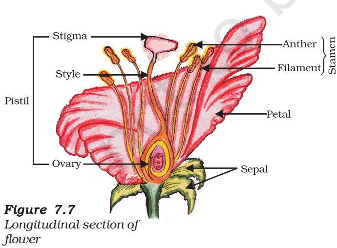

**reproduction incorporates such a process of combining DNA from two different individuals during reproduction.**

**But this creates a major difficulty. If each new generation is to be the combination of the DNA copies from two pre-existing individuals, then each new generation will end up having twice the amount of DNA that the previous generation had. This is likely to mess up the control of the cellular apparatus by the DNA. How many ways can we think of for solving this difficulty?**

**We have seen earlier that as organisms become more complex, the specialisation of tissue increases. One solution that many multi-cellular organisms have found for the problem mentioned above is to have special lineages of cells in specialised organs in which only half the number of chromosomes and half the amount of DNA as compared to the non-reproductive body cells. This is achieved by a process of cell division called meiosis. Thus, when these germ-cells from two individuals combine during sexual reproduction to form a new individual, it results in reestablishment of the number of chromosomes and the DNA content in the new generation.**

**If the zygote is to grow and develop into an organism which has highly specialised tissues and organs, then it has to have sufficient stores of energy for doing this. In very simple organisms, it is seen that the two germ-cells are not very different from one another, or may even be similar. But as the body designs become more complex, the germ-cells also specialise. One germ-cell is large and contains the food-stores while the other is smaller and likely to be motile. Conventionally, the motile germcell is called the male gamete and the germ-cell containing the stored food is called the female gamete. We shall see in the next few sections how the need to create these two different types of gametes give rise to differences in the male and female reproductive organs and, in some cases, differences in the bodies of the male and female organisms.**

## 7.3.2 Sexual Reproduction in Flowering Plants

**The reproductive parts of angiosperms are located in the flower. You have already studied the different parts of a flower – sepals, petals,**

**stamens and pistil. Stamens and pistil are the reproductive parts of a flower which contain the germ-cells. What possible functions could the petals and sepals serve?**

**The flower may be unisexual (papaya, watermelon) when it contains either stamens or pistil or bisexual (Hibiscus, mustard) when it contains both stamens and pistil. Stamen is the male reproductive part and it produces pollen grains that are yellowish in colour. You must have seen this yellowish powder that often sticks to our hands if we touch the stamen of a flower. Pistil is present in the centre of a flower and is the female reproductive part. It is made of three parts.**