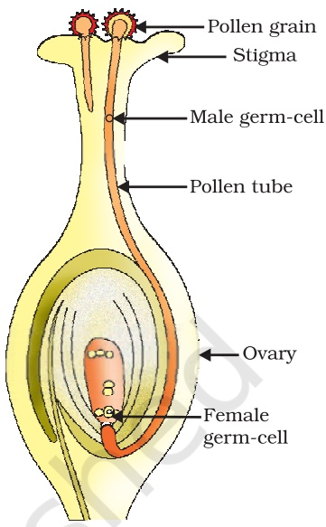
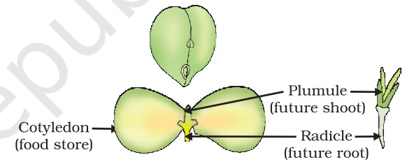

**The swollen bottom part is the ovary, middle elongated part is the style and the terminal part which may be sticky is the stigma. The ovary contains ovules and each ovule has an egg cell. The male germ-cell**

**produced by pollen grain fuses with the female gamete present in the ovule. This fusion of the germ-cells or fertilisation gives us the zygote which is capable of growing into a new plant.**

**Thus the pollen needs to be transferred from the stamen to the stigma. If this transfer of pollen occurs in the same flower, it is referred to as self-pollination. On the other hand, if the pollen is transferred from one flower to another, it is known as cross-pollination. This transfer of pollen from one flower to another is achieved by agents like wind, water or animals.**

**After the pollen lands on a suitable stigma, it has to reach the female germ-cells which are in the ovary. For this, a tube grows out of the pollen grain and travels through the style to reach the ovary.**

**After fertilisation, the zygote divides several times to form an embryo within the ovule. The ovule develops a tough coat and is gradually converted into a seed. The ovary grows rapidly and ripens to form a fruit. Meanwhile, the petals, sepals, stamens, style and stigma may shrivel and fall off. Have you ever observed any flower part still persisting in the fruit? Try and work out the advantages of seed-formation for the plant. The seed contains the future plant or embryo which develops into a seedling under appropriate conditions. This process is known as germination.**

Figure 7.8 Germination of pollen on stigma

## Activity 7.7

**Soak a few seeds of Bengal gram (chana) and keep them overnight.**

**Drain the excess water and cover the seeds with a wet cloth and leave them for a day. Make sure that the seeds do not become dry.**

Figure 7.9 Germination

**Cut open the seeds carefully and observe the different parts.**

**Compare your observations with the Fig. 7.9 and see if you can identify all the parts.**

## 7.3.3 Reproduction in Human Beings

**So far, we have been discussing the variety of modes that different species use for reproduction. Let us now look at the species that we are most interested in, namely, humans. Humans use a sexual mode of reproduction. How does this process work?**

**Let us begin at an apparently unrelated point. All of us know that our bodies change as we become older. You have learnt changes that take place in your body earlier in Class VIII also. We notice that our height has increased continuously from early age till now. We acquire teeth, we even lose the old, so-called milk teeth and acquire new ones.**