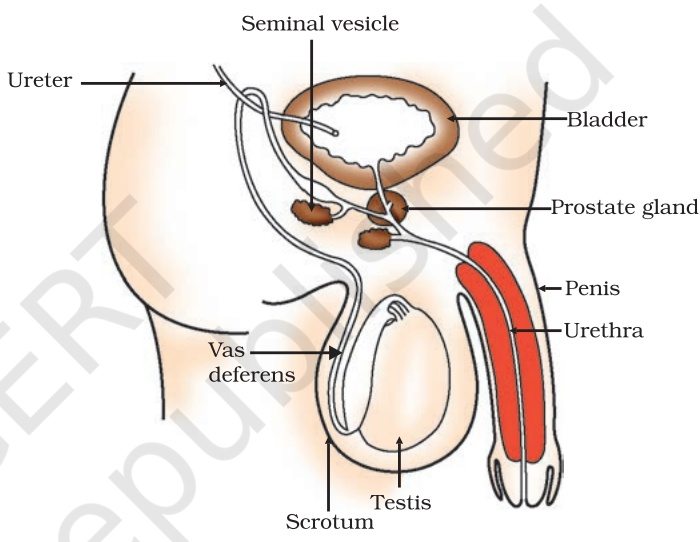
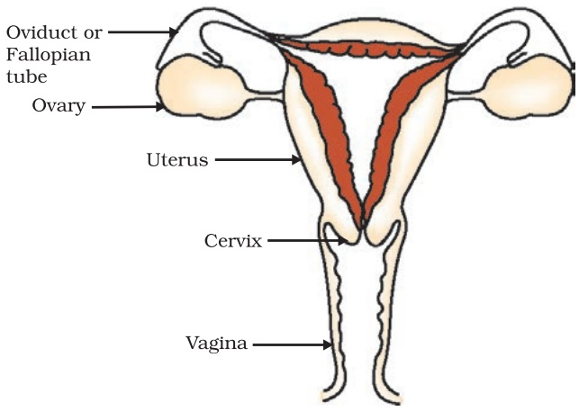

**participate in this process of mating, their state of sexual maturity must be identifiable by other individuals. Many changes during puberty, such as new hair-growth patterns, are signals that sexual maturation is taking place.**

**On the other hand, the actual transfer of germ-cells between two people needs special organs for the sexual act, such as the penis when it is capable of becoming erect. In mammals such as humans, the baby is carried in the mother’s body for a long period, and will be breast-fed later. The female reproductive organs and breasts will need to mature to accommodate these possibilities. Let us look at the systems involved in the process of sexual reproduction.**

## 7.3.3 (a) Male Reproductive System

**The male reproductive system (Fig. 7.10) consists of portions which produce the germ-cells and other portions that deliver the germ-cells to the site of fertilisation.**

**The formation of germ-cells or sperms takes place in the testes. These are located outside the abdominal cavity in scrotum because sperm formation requires a lower temperature than the normal body temperature. We have discussed the role of the testes in the secretion of the hormone, testosterone, in the previous chapter. In addition to regulating the formation of sperms, testosterone brings about changes in appearance seen in boys at the time of puberty.**

**The sperms formed are delivered through the vas deferens which unites with a tube coming from the urinary bladder. The urethra thus forms a common passage for both the sperms and urine. Along the path of the vas deferens, glands like the prostate and the seminal vesicles add their secretions so that the sperms are now in a fluid which makes their transport easier and this fluid also provides nutrition. The sperms are tiny bodies that consist of mainly genetic material and a long tail that helps them to move towards the female germ-cell.**

## 7.3.3 (b) Female Reproductive System

**The female germ-cells or eggs are made in the ovaries. They are also responsible for the production of some hormones. Look at Fig. 7.11 and identify the various organs in the female reproductive system.**

Figure 7.10 Human–male reproductive system

Figure 7.11 Human –female reproductive system