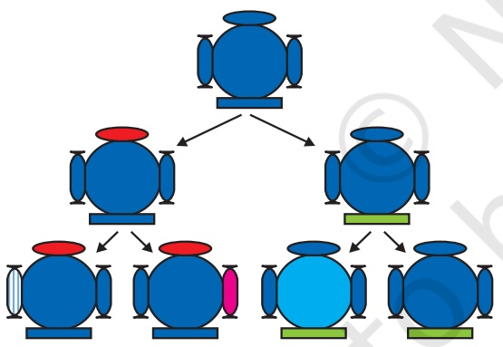

e have seen that reproductive processes give rise to new individuals **that are similar, but subtly different. We have discussed how some amount of variation is produced even during asexual reproduction. And the number of successful variations are maximised by the process of sexual reproduction. If we observe a field of sugarcane we find very little variations among the individual plants. But in a number of animals including human beings, which reproduce sexually, quite distinct variations are visible among different individuals. In this chapter, we shall be studying the mechanism by which variations are created and inherited.**

## 8.1 ACCUMULATION OF VARIATION DURING REPRODUCTION

## Figure 8.1

**Creation of diversity over succeeding generations. The original organism at the top will give rise to, say, two individuals, similar in body design, but with subtle differences. Each of them, in turn, will give rise to two individuals in the next generation. Each of the four individuals in the bottom row will be different from each other. While some of these differences will be unique, others will be inherited from their respective parents, who were different from each other.**

**Inheritance from the previous generation provides both a common basic body design, and subtle changes in it, for the next generation. Now think about what would happen when this new generation, in its turn, reproduces. The second generation will have differences that they inherit from the first generation, as well as newly created differences (Fig. 8.1).**

**Figure 8.1 would represent the situation if a single individual reproduces, as happens in asexual reproduction. If one bacterium divides, and then the resultant two bacteria divide again, the four individual bacteria generated would be very similar. There would be only very minor differences between them, generated due to small inaccuracies in DNA copying. However, if sexual reproduction is involved, even greater diversity will be generated, as we will see when we discuss the rules of inheritance.**

**Do all these variations in a species have equal chances of surviving in the environment in which they find themselves? Obviously not. Depending on the nature of variations, different individuals would have**