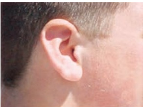
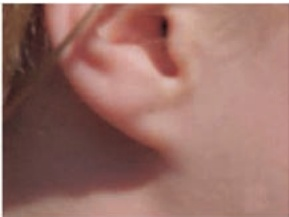

**different kinds of advantages. Bacteria that can withstand heat will survive better in a heat wave, as we have discussed earlier. Selection of variants by environmental factors forms the basis for evolutionary processes, as we will discuss in later sections.**

## Q U E S T I O N S

**1. If a trait A exists in 10% of a population of an asexually reproducing species and a trait B exists in 60% of the same population, which trait is likely to have arisen earlier?**

**2. How does the creation of variations in a species promote survival?**

## 8.2 HEREDITY

**The most obvious outcome of the reproductive process still remains the generation of individuals of similar design. The rules of heredity determine the process by which traits and characteristics are reliably inherited. Let us take a closer look at these rules.**

## 8.2.1 Inherited Traits

**What exactly do we mean by similarities and differences? We know that a child bears all the basic features of a human being. However, it does not look exactly like its parents, and human populations show a great deal of variation.**

## Activity 8.1

**Observe the ears of all the students in the class. Prepare a list of students having free or attached earlobes and calculate the percentage of students having each (Fig. 8.2). Find out about the earlobes of the parents of each student in the class. Correlate the earlobe type of each student with that of their parents. Based on this evidence, suggest a possible rule for the inheritance of earlobe types.**

(a)

## 8.2.2 Rules for the Inheritance of Traits – Mendel’s Contributions

**The rules for inheritance of such traits in human beings are related to the fact that both the father and the mother contribute practically equal amounts of genetic material to the child. This means that each trait can be influenced by both paternal and maternal DNA. Thus, for each trait there will be two versions in each child. What will, then, the trait seen in the child be? Mendel (see box) worked out the main rules of such inheritance, and it is interesting to look at some of his experiments from more than a century ago.**

(b)

Figure 8.2 **(a) Free and (b) attached earlobes. The lowest part of the ear, called the earlobe, is closely attached to the side of the head in some of us, and not in others. Free and attached earlobes are two variants found in human populations.**