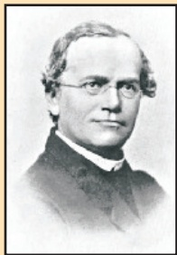
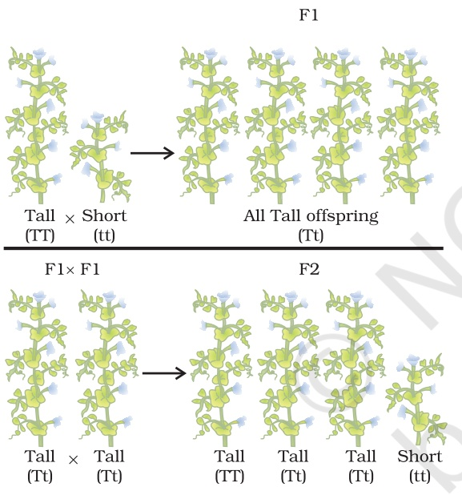

# Gregor Johann Mendel (1822–1884)

**Mendel was educated in a monastery and went on to study science and mathematics at the University of Vienna. Failure in the examinations for a teaching certificate did not suppress his zeal for scientific quest. He went back to his monastery and started growing peas. Many others had studied the inheritance of traits in peas and other organisms earlier, but Mendel blended his knowledge of science and mathematics and was the first one to keep count of individuals exhibiting a particular trait in each generation. This helped him to arrive at the laws of inheritance.**

**Mendel used a number of contrasting visible characters of garden peas – round/wrinkled seeds, tall/short plants, white/violet flowers and so on. He took pea plants with different characteristics – a tall plant and a short plant, produced progeny by crossing them, and calculated the percentages of tall or short progeny.**

**In the first place, there were no halfway characteristics in this firstgeneration, or F1 progeny – no ‘medium-height’ plants. All plants were** **tall. This meant that only one of the parental traits was seen, not some mixture of the two. So the next question was, were the tall plants in the F1 generation exactly the same as the tall plants of the parent generation? Mendelian experiments test this by getting both the parental plants and these F1 tall plants to reproduce by self-pollination. The progeny of the parental plants are, of course, all tall. However, the second-generation, or F2, progeny of the F1 tall plants are not all tall. Instead, one quarter of them are short. This indicates that both the tallness and shortness traits were inherited in the F1 plants, but only the tallness trait was expressed. This led Mendel to propose that two copies of factor (now called genes) controlling traits are present in sexually reproducing organism. These two may be identical, or may be different, depending on the parentage. A pattern of inheritance can be worked out with this assumption, as shown in Fig. 8.3.**

Figure 8.3 Inheritance of traits over two generations

## Activity 8.2

**In Fig. 8.3, what experiment would we do to confirm that the F2 generation did in fact have a 1:2:1 ratio of TT, Tt and tt trait combinations?**

**In this explanation, both TT and Tt are tall plants, while only tt is a short plant. In other words, a single copy of ‘T’ is enough to make the plant tall, while both copies have to be ‘t’ for the plant to be short. Traits like ‘T’ are called dominant traits, while those that behave like ‘t’ are called recessive traits. Work out which trait would be considered dominant and which one recessive in Fig. 8.4.**