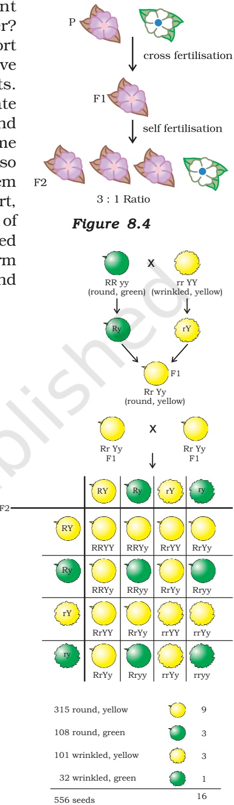

**What happens when pea plants showing two different characteristics, rather than just one, are bred with each other? What do the progeny of a tall plant with round seeds and a short plant with wrinkled-seeds look like? They are all tall and have round seeds. Tallness and round seeds are thus dominant traits. But what happens when these F1 progeny are used to generate F2 progeny by self-pollination? A Mendelian experiment will find that some F2 progeny are tall plants with round seeds, and some were short plants with wrinkled seeds. However, there would also be some F2 progeny that showed new combinations. Some of them would be tall, but have wrinkled seeds, while others would be short, but have round seeds. You can see as to how new combinations of traits are formed in F2 offspring when factors controlling for seed shape and seed colour recombine to form zygote leading to form F2 offspring (Fig. 8.5). Thus, the tall/short trait and the round seed/wrinkled seed trait are independently inherited.**

## 8.2.3 How do these Traits get Expressed?

**How does the mechanism of heredity work? Cellular DNA is the information source for making proteins in the cell. A section of DNA that provides information for one protein is called the gene for that protein. How do proteins control the characteristics that we are discussing here? Let us take the example of tallness as a characteristic. We know that plants have hormones that can trigger growth. Plant height can thus depend on the amount of a particular plant hormone. The amount of the plant hormone made will depend on the efficiency of the process for making it. Consider now an enzyme that is important for this process. If this enzyme works efficiently, a lot of hormone will be made, and the plant will be tall. If the gene for that enzyme has an alteration that makes the enzyme less efficient, the amount of hormone will be less, and the plant will be short. Thus, genes control characteristics, or traits.**

**If the interpretations of Mendelian experiments we have been discussing are correct, then both parents must be contributing equally to the DNA of the progeny during sexual reproduction. We have disscussed this issue in the previous Chapter. If both parents can help determine the trait in the progeny, both parents must be contributing a copy of the same gene. This means that each pea plant must have two sets of all genes, one inherited from each parent. For this mechanism to work, each germ cell must have only one gene set.**

**How do germ-cells make a single set of genes from the normal two copies that all other cells in the body have? If progeny plants inherited a single whole gene set from each parent, then the experiment explained in Fig. 8.5 cannot work. This is because the two characteristics ‘R’ and ‘y’ would then be linked to each other and cannot be independently**

rate traits, shape anFigure 8. 5

Independent inheritance of two separate traits, shape and colour of seeds