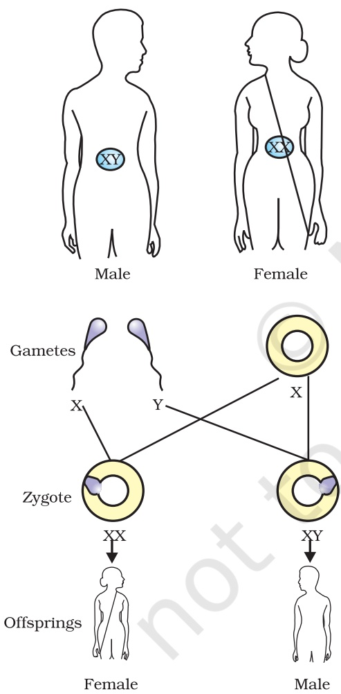

**inherited. This is explained by the fact that each gene set is present, not as a single long thread of DNA, but as separate independent pieces, each called a chromosome. Thus, each cell will have two copies of each chromosome, one each from the male and female parents. Every germcell will take one chromosome from each pair and these may be of either maternal or paternal origin. When two germ cells combine, they will restore the normal number of chromosomes in the progeny, ensuring the stability of the DNA of the species. Such a mechanism of inheritance explains the results of the Mendel experiments, and is used by all sexually reproducing organisms. But asexually reproducing organisms also follow similar rules of inheritance. Can we work out how their inheritance might work?**

## 8.2.4 Sex Determination

**We have discussed the idea that the two sexes participating in sexual reproduction must be somewhat different from each other for a number**

**Figure 8.6 Sex determination in human beings**

**of reasons. How is the sex of a newborn individual determined? Different species use very different strategies for this. Some rely entirely on environmental cues. Thus, in some animals like a few reptiles, the temperature at which fertilised eggs are kept determines whether the animals developing in the eggs will be male or female. In other animals, such as snails, individuals can change sex, indicating that sex is not genetically determined. However, in human beings, the sex of the individual is largely genetically determined. In other words, the genes inherited from our parents decide whether we will be boys or girls. But so far, we have assumed that similar gene sets are inherited from both parents. If that is the case, how can genetic inheritance determine sex?**

**The explanation lies in the fact that all human chromosomes are not paired. Most human chromosomes have a maternal and a paternal copy, and we have 22 such pairs. But one pair, called the sex chromosomes, is odd in not always being a perfect pair. Women have a perfect pair of sex chromosomes, both called X. But men have a mismatched pair in which one is a normal-sized X while the other is a short one called Y. So women are XX, while men are XY. Now, can we work out what the inheritance pattern of X and Y will be?**

**As Fig. 8.6 shows, half the children will be boys and half will be girls. All children will inherit an X chromosome from their mother regardless of whether they are boys or girls. Thus, the sex of the children will be determined by what they inherit from their father. A child who inherits an X chromosome from her father will be a girl, and one who inherits a Y chromosome from him will be a boy.**