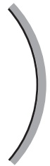
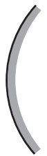

**Let us recall these laws –**

**(i) The angle of incidence is equal to the angle of reflection, and**

**(ii) The incident ray, the normal to the mirror at the point of incidence and the reflected ray, all lie in the same plane.**

**These laws of reflection are applicable to all types of reflecting surfaces including spherical surfaces. You are familiar with the formation of image by a plane mirror. What are the properties of the image? Image formed by a plane mirror is always virtual and erect. The size of the image is equal to that of the object. The image formed is as far behind the mirror as the object is in front of it. Further, the image is laterally inverted. How would the images be when the reflecting surfaces are curved? Let us explore.**

## Activity 9.1

**Take a large shining spoon. Try to view your face in its curved surface.**

n **Do you get the image? Is it smaller or larger?**

**Move the spoon slowly away from your face. Observe the image. How does it change?**

**Reverse the spoon and repeat the Activity. How does the image look like now?**

n **Compare the characteristics of the image on the two surfaces.**

**The curved surface of a shining spoon could be considered as a curved mirror. The most commonly used type of curved mirror is the spherical mirror. The reflecting surface of such mirrors can be considered to form a part of the surface of a sphere. Such mirrors, whose reflecting surfaces are spherical, are called spherical mirrors. We shall now study about spherical mirrors in some detail.**

## 9.2 SPHERICAL MIRRORS

**The reflecting surface of a spherical mirror may be curved inwards or outwards. A spherical mirror, whose reflecting surface is curved inwards, that is, faces towards the centre of the sphere, is called a concave mirror. A spherical mirror whose reflecting surface is curved outwards, is called a convex mirror. The schematic representation of these mirrors is shown** **in Fig. 9.1. You may note in these diagrams that the back of the mirror is shaded.**

**You may now understand that the surface of the spoon curved inwards can be approximated to a concave mirror and the surface of the spoon bulged outwards can be approximated to a convex mirror.**

**Before we move further on spherical mirrors, we need to recognise and understand the meaning of a few terms. These terms are commonly used in discussions about spherical mirrors. The centre of the reflecting surface of a spherical mirror is a point called the pole. It lies on the surface of the mirror. The pole is usually represented by the letter P.**

**(a) Concave mirror**

**(b) Convex mirror**

**Figure 9.1**

**Schematic representation of spherical mirrors; the shaded side is non-reflecting.**