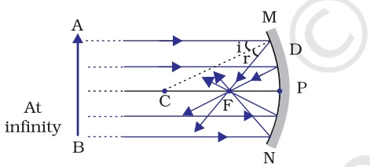
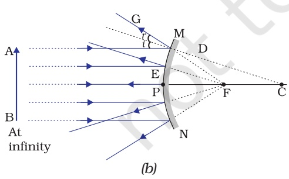

**The reflecting surface of a spherical mirror forms a part of a sphere. This sphere has a centre. This point is called the centre of curvature of the spherical mirror. It is represented by the letter C. Please note that the centre of curvature is not a part of the mirror. It lies outside its reflecting surface. The centre of curvature of a concave mirror lies in front of it. However, it lies behind the mirror in case of a convex mirror. You may note this in Fig.9.2 (a) and (b). The radius of the sphere of which the reflecting surface of a spherical mirror forms a part, is called the radius of curvature of the mirror. It is represented by the letter R. You may note that the distance PC is equal to the radius of curvature. Imagine a straight line passing through the pole and the centre of curvature of a spherical mirror. This line is called the principal axis. Remember that principal axis is normal to the mirror at its pole. Let us understand an important term related to mirrors, through an Activity.**

## Activity 9.2

**CAUTION: Do not look at the Sun directly or even into a mirror reflecting sunlight. It may damage your eyes.**

**Hold a concave mirror in your hand and direct its reflecting surface towards the Sun.**

**Direct the light reflected by the mirror on to a sheet of paper held close to the mirror.**

**Move the sheet of paper back and forth gradually until you find on the paper sheet a bright, sharp spot of light.**

**Hold the mirror and the paper in the same position for a few minutes. What do you observe? Why?**

**The paper at first begins to burn producing smoke. Eventually it may even catch fire. Why does it burn? The light from the Sun is converged at a point, as a sharp, bright spot by the mirror. In fact, this spot of light**

Figure 9.2 (a) Concave mirror (b) Convex mirror

**is the image of the Sun on the sheet of paper. This point is the focus of the concave mirror. The heat produced due to the concentration of sunlight ignites the paper. The distance of this image from the position of the mirror gives the approximate value of focal length of the mirror.**

**Let us try to understand this observation with the help of a ray diagram.**

**Observe Fig.9.2 (a) closely. A number of rays parallel to the principal axis are falling on a concave mirror. Observe the reflected rays. They are all meeting/intersecting at a point on the principal axis of the mirror. This point is called the principal focus of the concave mirror. Similarly, observe Fig. 9.2 (b). How are the rays parallel to the principal axis, reflected by a convex mirror? The reflected rays appear to come from a point on the principal axis. This point is called the principal focus of the convex mirror. The principal focus is represented by the letter F. The distance between the pole and the principal focus of a spherical mirror is called the focal length. It is represented by the letter f.**