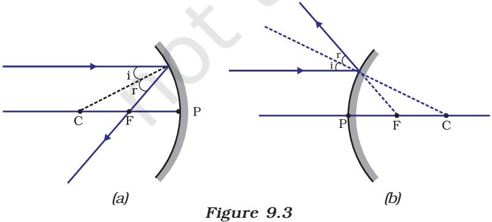

**You will see in the above Activity that the nature, position and size of the image formed by a concave mirror depends on the position of the object in relation to points P, F and C. The image formed is real for some positions of the object. It is found to be a virtual image for a certain other position. The image is either magnified, reduced or has the same size, depending on the position of the object. A summary of these observations is given for your reference in Table 9.1.**

Table 9.1 Image formation by a concave mirror for different positions of the object

| Position of the | Position of the | Size of the | Nature of the |
| --- | --- | --- | --- |
| object | image | image | image |
| At infinity | At the focus F | Highly diminished, point-sized | Real and inverted |
| Beyond C | Between F and C | Diminished | Real and inverted |
| At C | At C | Same size | Real and inverted |
| Between C and F | Beyond C | Enlarged | Real and inverted |
| At F | At infinity | Image would | not be formed |
| Between P and F | Behind the mirror | Enlarged | Virtual and erect |

## 9.2.2 Representation of Images Formed by Spherical Mirrors Using Ray Diagrams

**We can also study the formation of images by spherical mirrors by drawing ray diagrams. Consider an extended object, of finite size, placed in front of a spherical mirror. Each small portion of the extended object acts like a point source. An infinite number of rays originate from each of these points. To construct the ray diagrams, in order to locate the image of an object, an arbitrarily large number of rays emanating from a point could be considered. However, it is more convenient to consider only two rays, for the sake of clarity of the ray diagram. These rays are so chosen that it is easy to know their directions after reflection from the mirror.**

**The intersection of at least two reflected rays give the position of image of the point object. Any two of the following rays can be considered for locating the image.**

**(i)** A ray parallel to the principal axis**, after reflection, will pass through the principal focus in case of a concave mirror or appear to diverge from the principal focus in case of a convex mirror. This is illustrated in Fig.9.3 (a) and (b).**