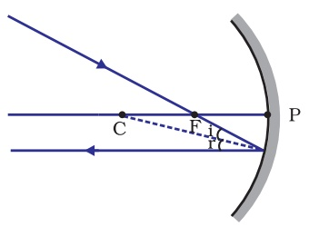
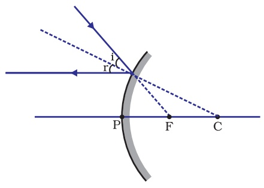
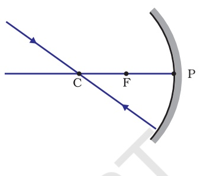
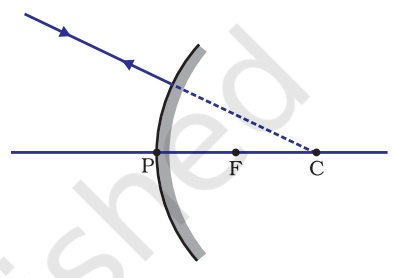
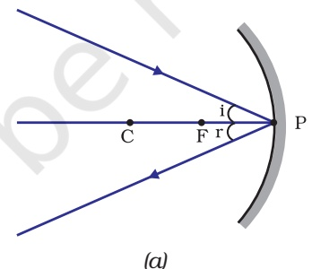
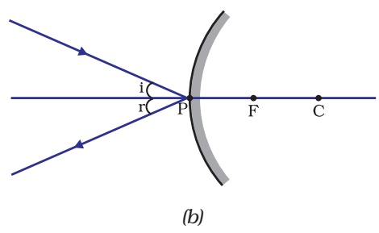

**(ii) A ray passing through the principal focus of a concave mirror or a ray which is directed towards the principal focus of a convex mirror, after reflection, will emerge parallel to the principal axis. This is illustrated in Fig.9.4 (a) and (b).**

**(iii) A ray passing through the centre of curvature of a concave mirror or directed in the direction of the centre of curvature of a convex mirror, after reflection, is reflected back along the same path. This is illustrated in Fig.9.5 (a) and (b). The light rays come back along the same path because the incident rays fall on the mirror along the normal to the reflecting surface.**

**(iv) A ray incident obliquely to the principal axis, towards a point P (pole of the mirror), on the concave mirror [Fig. 9.6 (a)] or a convex mirror [Fig. 9.6 (b)], is reflected obliquely. The incident and reflected rays follow the laws of reflection at the point of incidence (point P), making equal** angles with the principal axis

(a)

(b)

Figure 9.4

(a)

Figure 9.5

(b)

(a)

Figure 9.6

**Remember that in all the above cases the laws of reflection are followed. At the point of incidence, the incident ray is reflected in such a way that the angle of reflection equals the angle of incidence.**

## (a) Image formation by Concave Mirror

**Figure 9.7 illustrates the ray diagrams for the formation of image by a concave mirror for various positions of the object.**