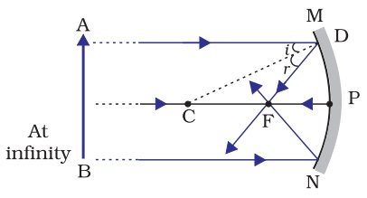
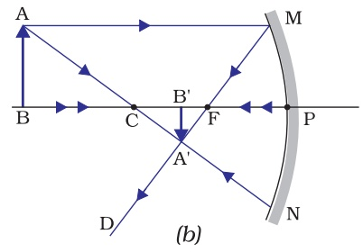
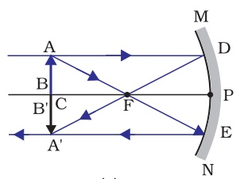
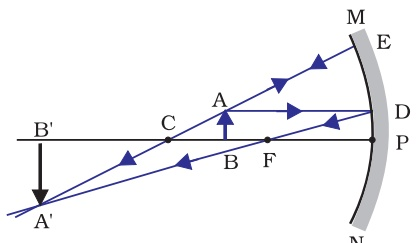
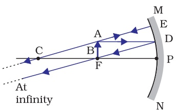
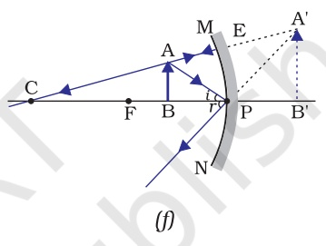

(a)

(c)

(d)

(e)

Figure 9.7 Ray diagrams for the image formation by a concave mirror

## Activity 9.4

**Draw neat ray diagrams for each position of the object shown in Table 9.1.**

**You may take any two of the rays mentioned in the previous section for locating the image.**

n **Compare your diagram with those given in Fig. 9.7.**

**Describe the nature, position and relative size of the image formed in each case.**

n **Tabulate the results in a convenient format.**

## Uses of concave mirrors

**Concave mirrors are commonly used in torches, search-lights and vehicles headlights to get powerful parallel beams of light. They are often used as shaving mirrors to see a larger image of the face. The dentists use concave mirrors to see large images of the teeth of patients. Large concave mirrors are used to concentrate sunlight to produce heat in solar furnaces.**

## (b) Image formation by a Convex Mirror

**We studied the image formation by a concave mirror. Now we shall study the formation of image by a convex mirror.**