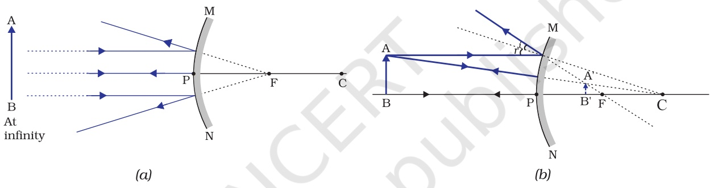

## Activity 9.5

n **Take a convex mirror. Hold it in one hand.**

n **Hold a pencil in the upright position in the other hand.**

**Observe the image of the pencil in the mirror. Is the image erect or inverted? Is it diminished or enlarged?**

**Move the pencil away from the mirror slowly. Does the image become smaller or larger?**

**Repeat this Activity carefully. State whether the image will move closer to or farther away from the focus as the object is moved away from the mirror?**

**We consider two positions of the object for studying the image formed by a convex mirror. First is when the object is at infinity and the second position is when the object is at a finite distance from the mirror. The ray diagrams for the formation of image by a convex mirror for these two positions of the object are shown in Fig.9.8 (a) and (b), respectively. The results are summarised in Table 9.2.**

Figure 9.8 Formation of image by a convex mirror

Table 9.2 Nature, position and relative size of the image formed by a convex mirror

| Position of the | Position of the | Size of the | Nature of the |
| --- | --- | --- | --- |
| object | image | image | image |
| At infinity | At the focus F, behind the mirror | Highly diminished, point-sized | Virtual and erect |
| Between infinity | Between P and F, | Diminished | Virtual and erect |
| and the pole P of | behind the mirror |  |  |
| the mirror |  |  |  |

**You have so far studied the image formation by a plane mirror, a concave mirror and a convex mirror. Which of these mirrors will give the full image of a large object? Let us explore through an Activity.**

## Activity 9.6

**Observe the image of a distant object, say a distant tree, in a plane mirror.**

n **Could you see a full-length image?**