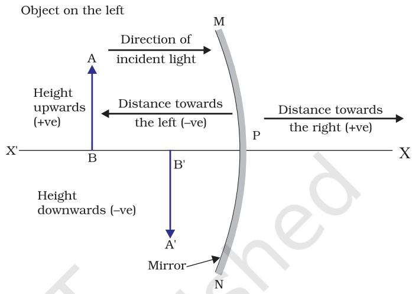

Figure 9.9

**The New Cartesian Sign Convention described above is illustrated in Fig.9.9 for your reference. These sign conventions are applied to obtain the mirror formula and solve related numerical problems.**

## 9.2.4 Mirror Formula and Magnification

**In a spherical mirror, the distance of the object from its pole is called the object distance (u). The distance of the image from the pole of the mirror is called the image distance (v). You already know that the distance of the principal focus from the pole is called the focal length (f) . There is a relationship between these three quantities given by the mirror formula which is expressed as**

$$
\frac { 1 } { v } + \frac { 1 } { u } = \frac { 1 } { f }\tag{9.1}
$$

**This formula is valid in all situations for all spherical mirrors for all positions of the object. You must use the New Cartesian Sign Convention while substituting numerical values for u, v, f, and R in the mirror formula for solving problems.**

The New Cartesian Sign Convention for spherical mirrors

## Magnification

**Magnification produced by a spherical mirror gives the relative extent to which the image of an object is magnified with respect to the object size. It is expressed as the ratio of the height of the image to the height of the object. It is usually represented by the letter m.**

**If h is the height of the object and h**′ **is the height of the image, then the magnification m produced by a spherical mirror is given by**

$$
m = { \frac { \mathrm { H e i g h t ~ o f ~ t h e ~ i m a g e } \left( h ^ { \prime } \right) } { \mathrm { H e i g h t ~ o f ~ t h e ~ o b j e c t } \left( h \right) } }
$$

$$
m = { \frac { h ^ { \prime } } { h } }\tag{9.2}
$$

**The magnification m is also related to the object distance (u) and image distance (v). It can be expressed as:**

$$
\mathrm{Magniification} \left( \underline{m} \right) = \frac{h'}{h} = - \frac{v}{u}\tag{9.3}
$$

**You may note that the height of the object is taken to be positive as the object is usually placed above the principal axis. The height of the image should be taken as positive for virtual images. However, it is to be taken as negative for real images. A negative sign in the value of the magnification indicates that the image is real. A positive sign in the value of the magnification indicates that the image is virtual.**