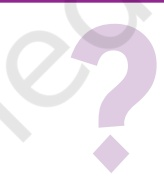

$$
\frac{1}{v}=\frac{-5.0+3.0}{75.0}=\frac{-2.0}{75.0}\  or , v=-37.5\  cm
$$

**The screen should be placed at 37.5 cm in front of the mirror. The image is real.**

Also, magnification, $m = { \frac { h   ^ { \prime } } { h } } = - { \frac { v } { u } }$

$$
\mathrm{or}, h' = - \frac{v h}{u} = - \frac{(-37.5   \mathrm{cm})   (+4.0   \mathrm{cm})}{(-25.0   \mathrm{cm})}
$$

Height of the image, $h^{\prime}=-6.0\  cm$

**The image is inverted and enlarged.**

## Q U E S T I O N S

**1. Find the focal length of a convex mirror whose radius of curvature is 32 cm.**

**2. A concave mirror produces three times magnified (enlarged) real image of an object placed at 10 cm in front of it. Where is the image located?**

## 9.3 REFRACTION OF LIGHT

**Light seems to travel along straight-line paths in a transparent medium. What happens when light enters from one transparent medium to another? Does it still move along a straight-line path or change its direction? We shall recall some of our day-to-day experiences.**

**You might have observed that the bottom of a tank or a pond containing water appears to be raised. Similarly, when a thick glass slab is placed over some printed matter, the letters appear raised when viewed through the glass slab. Why does it happen? Have you seen a pencil partly immersed in water in a glass tumbler? It appears to be displaced at the interface of air and water. You might have observed that a lemon kept in water in a glass tumbler appears to be bigger than its actual size, when viewed from the sides. How can you account for such experiences?**

**Let us consider the case of the apparent displacement of a pencil, partly immersed in water. The light reaching you from the portion of the pencil inside water seems to come from a different direction, compared to the part above water. This makes the pencil appear to be displaced at the interface. For similar reasons, the letters appear to be raised, when seen through a glass slab placed over it.**

**Does a pencil appear to be displaced to the same extent, if instead of water, we use liquids like kerosene or turpentine? Will the letters appear to rise to the same height if we replace a glass slab with a transparent plastic slab? You will find that the extent of the effect is different for different pair of media. These observations indicate that light does not**