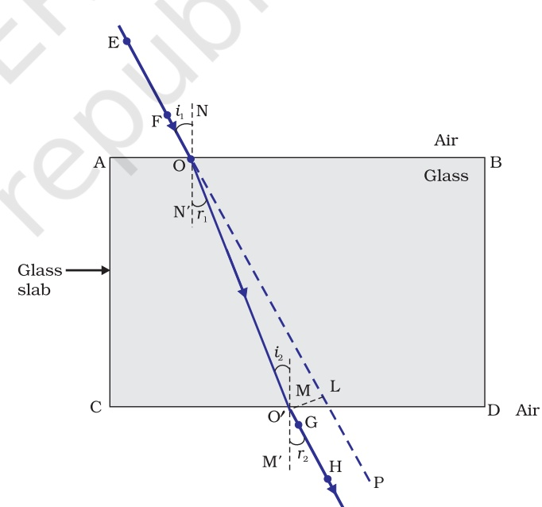

## Activity 9.10

n **Fix a sheet of white paper on a drawing board using drawing pins.**

n **Place a rectangular glass slab over the sheet in the middle.**

**Draw the outline of the slab with a pencil. Let us name the outline as ABCD.**

n **Take four identical pins.**

**Fix two pins, say E and F, vertically such that the line joining the pins is inclined to the edge AB.**

**Look for the images of the pins E and F through the opposite edge. Fix two other pins, say G and H, such that these pins and the images of E and F lie on a straight line.**

n **Remove the pins and the slab.**

**Join the positions of tip of the pins E and F and produce the line up to AB. Let EF meet AB at O. Similarly, join the positions of tip of the pins G and H and produce it up to the edge CD. Let HG meet CD at O** ′.

**Join O and O**′**. Also produce EF up to P, as shown by a dotted line in Fig. 9.10.**

**In this Activity, you will note, the light ray has changed its direction at points O and O**′**. Note that both the points O and O**′ **lie on surfaces separating two transparent media. Draw a perpendicular NN’ to AB at O and another perpendicular MM**′ **to CD at O**′**. The light ray at point O has entered from a rarer medium to a denser medium, that is, from air to**

**glass. Note that the light ray has bent towards the normal. At O** ′**, the light ray has entered from glass to air, that is, from a denser medium to a rarer medium. The light here has bent away from the normal. Compare the angle of incidence with the angle of refraction at both refracting surfaces AB and CD.**

**In Fig. 9.10, a ray EO is obliquely incident on surface AB, called incident ray. OO** ′ **is the refracted ray and O**′ **H is the emergent ray. You may observe that the emergent ray is parallel to the direction of the incident ray. Why does it happen so? The extent of bending of the ray of light at the opposite parallel faces AB (air-glass interface) and CD (glass-air interface) of the rectangular glass slab is equal and opposite. This is why the ray emerges parallel to the incident ray. However, the light ray is shifted sideward slightly. What happens when a light ray is incident normally to the interface of two media? Try and find out.**

Figure 9.10

Refraction of light through a rectangular glass slab

**Now you are familiar with the refraction of light. Refraction is due to change in the speed of light as it enters from one transparent medium to another. Experiments show that refraction of light occurs according to certain laws.**