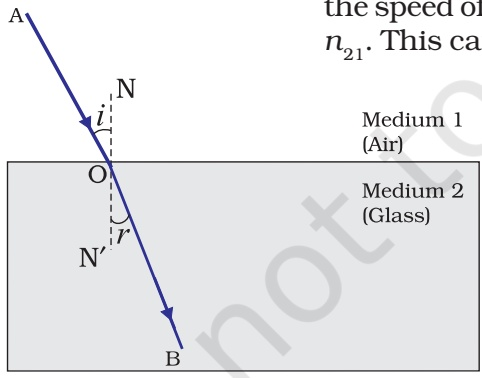

**The following are the laws of refraction of light.**

**(i) The incident ray, the refracted ray and the normal to the interface of two transparent media at the point of incidence, all lie in the same plane.**

**(ii) The ratio of sine of angle of incidence to the sine of angle of refraction is a constant, for the light of a given colour and for the given pair of media. This law is also known as Snell’s law of** refraction. (This is true for angle $0 < i   <   9 0 ^ { \circ } )$

**If i is the angle of incidence and r is the angle of refraction, then,**

$$
\frac { \sin i } { \sin r } = c o n s t a n t\tag{9.4}
$$

**This constant value is called the refractive index of the second medium with respect to the first. Let us study about refractive index in some detail.**

## 9.3.2 The Refractive Index

**You have already studied that a ray of light that travels obliquely from one transparent medium into another will change its direction in the second medium. The extent of the change in direction that takes place in a given pair of media may be expressed in terms of the refractive index, the “constant” appearing on the right-hand side of Eq.(9.4).**

**The refractive index can be linked to an important physical quantity, the relative speed of propagation of light in different media. It turns out that light propagates with different speeds in different media. Light** travels fastest in vacuum with speed of $3 \times 10^{8}    m     s ^{-1}$ **. In air, the speed of light is only marginally less, compared to that in vacuum. It reduces considerably in glass or water. The value of the refractive index for a given pair of media depends upon the speed of light in the two media, as given below.**

**Consider a ray of light travelling from medium 1 into medium 2, as** shown in Fig.9.11. Let $v _ { \mathrm { { _ 1 } } }$ **be the** speed of light in medium 1 and $v _ { 2 }$ be the **speed of light in medium 2. The refractive index of medium 2 with respect to medium 1 is given by the ratio of the speed of light in medium 1 and the speed of light in medium 2. This is usually represented by the symbol** $n _ { _ { 2 1 } }$ **. This can be expressed in an equation form as**

Figure 9.11

$$
n_{21} = \frac{\textrm{Specd of light in medium 1}}{\textrm{Specd of light in medium 2}} = \frac{v_1}{v_2}\tag{9.5}
$$

**By the same argument, the refractive index of medium 1 with respect to medium 2 is represented as** $n _ { _ { I 2 ^ { \circ } } }$ **It is given by**

$$
n_{12}=\frac{\text { speed of light in medium 2}}{\text { speed of light in medium 1}}=\frac{v_{2}}{v_{1}}\tag{9.6}
$$

**If medium 1 is vacuum or air, then the refractive index of medium 2 is considered with respect to vacuum. This is called the absolute refractive** index of the medium. It is simply represented as $n _ { \mathrm { 2 } }$ **. If c is the speed of**