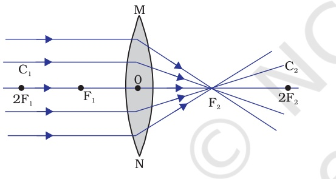
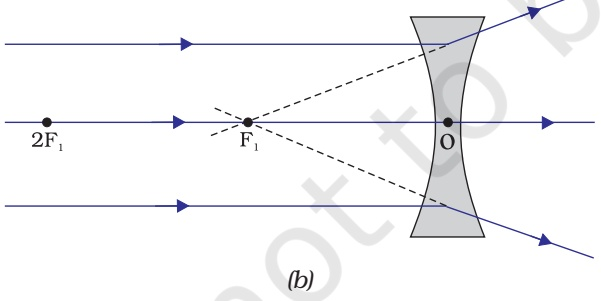

## Q U E S T I O N S

**1. A ray of light travelling in air enters obliquely into water. Does the light ray bend towards the normal or away from the normal? Why?**

**2. Light enters from air to glass having refractive index 1.50. What is the** speed of light in the glass? The speed of light in vacuum is $3 \times 1 0 ^ { 8 }$ **m s**<strong>–1</strong>.

**3. Find out, from Table 9.3, the medium having highest optical density. Also find the medium with lowest optical density.**

**4. You are given kerosene, turpentine and water. In which of these does the light travel fastest? Use the information given in Table 9.3.**

**5. The refractive index of diamond is 2.42. What is the meaning of this statement?**

## 9.3.3 Refraction by Spherical Lenses

**You might have seen watchmakers using a small magnifying glass to see tiny parts. Have you ever touched the surface of a magnifying glass with your hand? Is it plane surface or curved? Is it thicker in the middle or at the edges? The glasses used in spectacles and that by a watchmaker are examples of lenses. What is a lens? How does it bend light rays? We shall discuss these in this section.**

**A transparent material bound by two surfaces, of which one or both**

(a)

Figure 9.12

(a) Converging action of a convex lens, (b) diverging action of a concave lens

**surfaces are spherical, forms a lens. This means that a lens is bound by at least one spherical surface. In such lenses, the other surface would be plane. A lens may have two spherical surfaces, bulging outwards. Such a lens is called a double convex lens. It is simply called a convex lens. It is thicker at the middle as compared to the edges. Convex lens converges light rays as shown in Fig. 9.12 (a). Hence convex lenses are also called converging lenses. Similarly, a double concave lens is bounded by two spherical surfaces, curved inwards. It is thicker at the edges than at the middle. Such lenses diverge light rays as shown in Fig. 9.12 (b). Such lenses are also called diverging lenses. A double concave lens is simply called a concave lens.**

**A lens, either a convex lens or a concave lens, has two spherical surfaces. Each of these surfaces forms a part of a sphere. The centres of these spheres are called centres of curvature of the lens. The centre of curvature of a lens is usually represented by the letter C. Since there are two** centres of curvature, we may represent them as $\mathbf { C } _ { \mathrm { { i } } }$ and $\mathbf { C } _ { 2 } .$ **An imaginary straight line passing through the two centres of curvature of a lens is called its principal axis. The central point of a lens is its optical centre. It is**