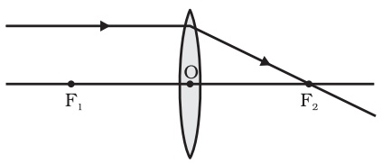
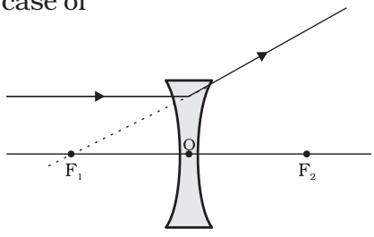

## Activity 9.13

n **Take a concave lens. Place it on a lens stand.**

n **Place a burning candle on one side of the lens.**

**Look through the lens from the other side and observe the image. Try to get the image on a screen, if possible. If not, observe the image directly through the lens.**

**Note down the nature, relative size and approximate position of the image.**

**Move the candle away from the lens. Note the change in the size of the image. What happens to the size of the image when the candle is placed too far away from the lens.**

**The summary of the above Activity is given in Table 9.5 below.**

Table 9.5 Nature, position and relative size of the image formed by a concave lens for various positions of the object

<table><tr><td>Position of theobject</td><td>Position ofthe image</td><td>Relative size ofthe image</td><td>Nature ofthe image</td></tr><tr><td>At infinity</td><td>At focus F</td><td>Highly diminished,point-sized</td><td>Virtual and erect</td></tr><tr><td>Between infinity and</td><td rowspan=2>Between focus F,and optical centreO</td><td rowspan=2>Diminished</td><td rowspan=2>Virtual and erect</td></tr><tr><td>optical centre Oof the lens</td></tr></table>

**What conclusion can you draw from this Activity? A concave lens will always give a virtual, erect and diminished image, irrespective of the position of the object.**

## 9.3.5 Image Formation in Lenses Using Ray Diagrams

**We can represent image formation by lenses using ray diagrams. Ray diagrams will also help us to study the nature, position and relative size of the image formed by lenses. For drawing ray diagrams in lenses, alike of spherical mirrors, we consider any two of the following rays –**

**(i) A ray of light from the object, parallel to the principal axis, after refraction from a convex lens, passes through the principal focus on the other side of the lens, as shown in Fig. 9.13 (a). In case of a concave lens,**

**the ray appears to diverge from the principal focus located on the same side of the lens, as shown in Fig. 9.13 (b).**

(a)

Figure 9.13

(b)