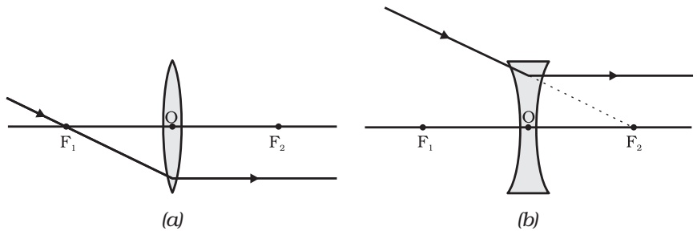
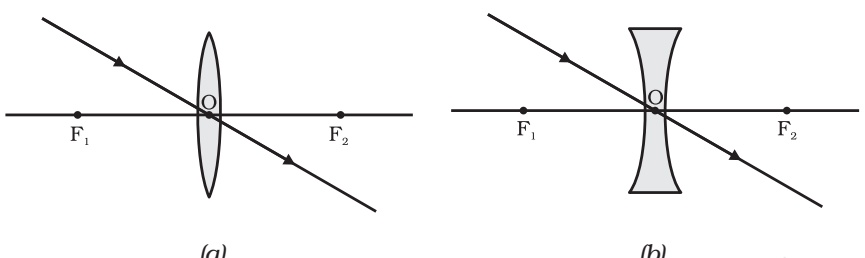
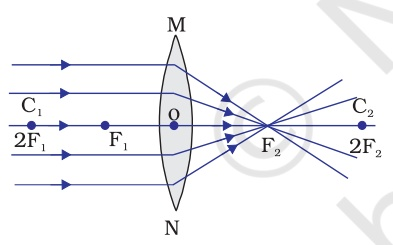
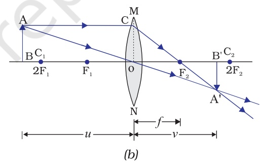
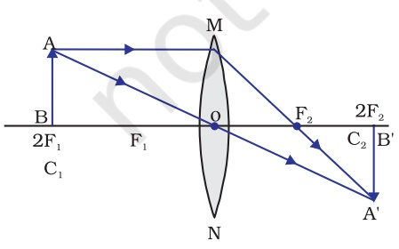
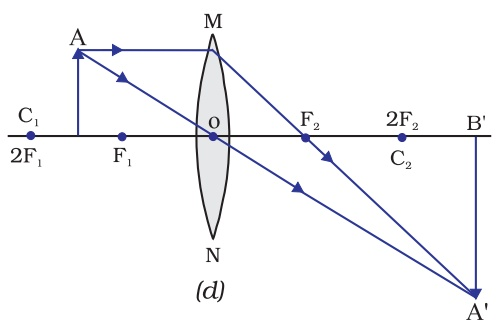

Figure 9.14

(a)

Figure 9.15

(b)

**(ii) A ray of light passing through a principal focus, after refraction from a convex lens, will emerge parallel to the principal axis. This is shown in Fig. 9.14 (a). A ray of light appearing to meet at the principal focus of a concave lens, after refraction, will emerge parallel to the principal axis. This is shown in Fig.9.14 (b).**

**(iii) A ray of light passing through the optical centre of a lens will emerge without any deviation. This is illustrated in Fig.9.15(a) and Fig.9.15 (b).**

**The ray diagrams for the image formation in a convex lens for a few positions of the object are shown in Fig. 9.16. The ray diagrams representing the image formation in a concave lens for various positions of the object are shown in Fig. 9.17.**

(a)

(c)

