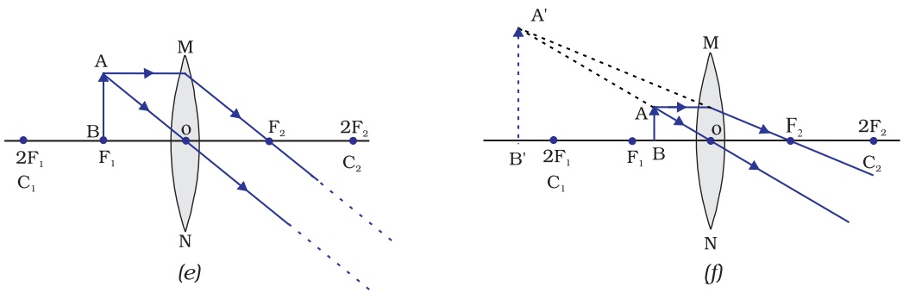
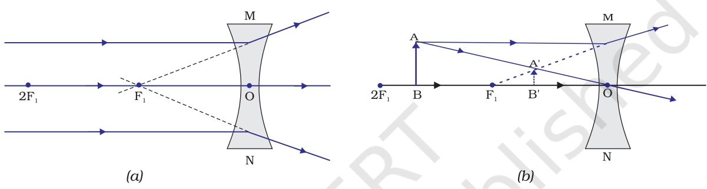

Figure 9.16 The position, size and the nature of the image formed by a convex lens for various positions of the object

Figure 9.17 Nature, position and relative size of the image formed by a concave lens

## 9.3.6 Sign Convention for Spherical Lenses

**For lenses, we follow sign convention, similar to the one used for spherical mirrors. We apply the rules for signs of distances, except that all measurements are taken from the optical centre of the lens. According to the convention, the focal length of a convex lens is positive and that of a concave lens is negative. You must take care to apply appropriate signs for the values of u,** $v , f ,$ **object height h and image height h**′.

## 9.3.7 Lens Formula and Magnification

**As we have a formula for spherical mirrors, we also have formula for spherical lenses. This formula gives the relationship between objectdistance (u), image-distance (v) and the focal length (f ). The lens formula is expressed as**

$$
\frac { 1 } { v } - \frac { 1 } { u } = \frac { 1 } { f }\tag{9.8}
$$

**The lens formula given above is general and is valid in all situations for any spherical lens. Take proper care of the signs of different quantities, while putting numerical values for solving problems relating to lenses.**