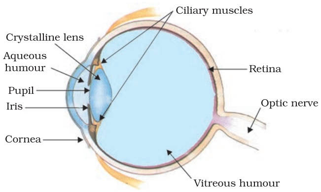

# CHAPTER10 The Human Eye and the Colourful World

1064CH11

ou have studied in the previous chapter about refraction of light by lenses. You also studied the nature, position and relative size of **images formed by lenses. How can these ideas help us in the study of the human eye? The human eye uses light and enables us to see objects around us. It has a lens in its structure. What is the function of the lens in a human eye? How do the lenses used in spectacles correct defects of vision? Let us consider these questions in this chapter.**

**We have learnt in the previous chapter about light and some of its properties. In this chapter, we shall use these ideas to study some of the optical phenomena in nature. We shall also discuss about rainbow formation, splitting of white light and blue colour of the sky.**

## 10.1 THE HUMAN EYE

**The human eye is one of the most valuable and sensitive sense organs. It enables us to see the wonderful world and the colours around us. On closing the eyes, we can identify objects to some extent by their smell, taste, sound they make or by touch. It is, however, impossible to identify colours while closing the eyes. Thus, of all the sense organs, the human eye is the most significant one as it enables us to see the beautiful, colourful world around us.**

**The human eye is like a camera. Its lens system forms an image on a light-sensitive screen called the retina. Light enters the eye through a thin membrane called the cornea. It forms the transparent bulge on the front surface of the eyeball as shown in Fig. 10.1. The eyeball is approximately spherical in shape with a diameter of about 2.3 cm. Most of the refraction for the light rays entering the eye occurs at the outer surface of the cornea. The crystalline lens merely provides the finer adjustment of focal length required to focus** **objects at different distances on the retina. We find a structure called iris behind the cornea. Iris is a dark muscular diaphragm that controls the size of the pupil. The pupil regulates and controls the amount of light**

Figure 10.1 The human eye