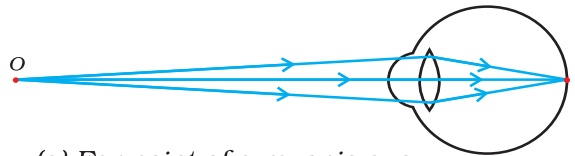
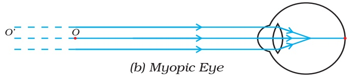
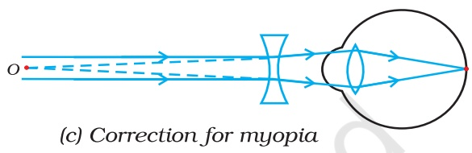
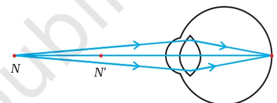
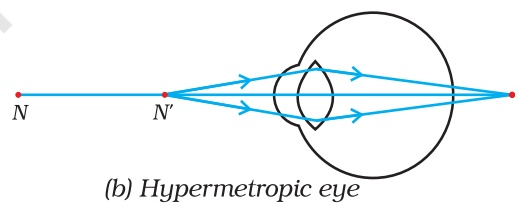
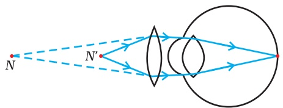

## (a) Myopia

**Myopia is also known as near - sightedness. A person with myopia can see nearby objects clearly but cannot see distant objects distinctly. A person with this defect has the far point nearer than infinity. Such a person may see clearly upto a distance of a few metres. In a myopic eye, the image of a distant object is formed in front of the retina [Fig. 10.2 (b)] and not at the retina itself. This defect may arise due to (i) excessive curvature of the eye lens, or (ii) elongation of the eyeball. This defect can be corrected by using a concave lens of suitable power. This is illustrated in Fig. 10.2 (c). A concave lens of suitable power will bring the image back on to the** retina and thus the defect is corrected. retina and thus the defect is correct

(α) Far point of a myopic eye

Figure 10.2 (a), (b) The myopic eye, and (c) correction for myopia with a concave lens

## (b) Hypermetropia

**Hypermetropia is also known as far-sightedness. A person with hypermetropia can see distant objects clearly but cannot see nearby objects distinctly. The near point, for the person, is farther away from the normal near point (25 cm). Such a person has to keep a reading material much beyond 25 cm from the eye for comfortable reading. This is because the light rays from a closeby object are focussed at a point behind the retina as shown in Fig. 10.3 (b). This defect arises either because (i) the focal length of the eye lens is too long, or (ii) the eyeball has become too small. This defect can be corrected by using a convex lens of appropriate power. This is illustrated in Fig. 10.3 (c). Eye-glasses with converging lenses provide the additional focussing power required for forming the image on the retina.**

## (c) Presbyopia

**The power of accommodation of the eye usually decreases with ageing. For most people, the near point gradually recedes away. They find it difficult to see nearby objects comfortably and distinctly without corrective eye-glasses. This defect is called Presbyopia. It arises due to the gradual**

(α) Near point of a Hypermetropic eye

(c) Correction for Hypermetropic eye

## Figure 10.3

**(a), (b) The hypermetropic eye, and (c) correction for hypermetropia**

**N = Near point of a hypermetropic eye.**

N’ **= Near point of a normal eye.**