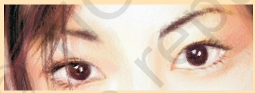

**weakening of the ciliary muscles and diminishing flexibility of the eye lens. Sometimes, a person may suffer from both myopia and hypermetropia. Such people often require bi-focal lenses. A common type of bi-focal lenses consists of both concave and convex lenses. The upper portion consists of a concave lens. It facilitates distant vision. The lower part is a convex lens. It facilitates near vision.**

**These days, it is possible to correct the refractive defects with contact lenses or through surgical interventions.**

## Q U E S T I O N S

**1. What is meant by power of accommodation of the eye?**

**2. A person with a myopic eye cannot see objects beyond 1.2 m distinctly. What should be the type of the corrective lens used to restore proper vision?**

**3. What is the far point and near point of the human eye with normal vision?**

**4. A student has difficulty reading the blackboard while sitting in the last row. What could be the defect the child is suffering from? How can it be corrected?**

## Think it over

**You talk of wondrous things you see, You say the sun shines bright; I feel him warm, but how can he Or make it day or night?**

**– C. CIBBER**

**Do you know that our eyes can live even after our death? By donating our eyes after we die, we can light the life of a blind person.**

**About 35 million people in the developing world are blind and most of them can be cured. About 4.5 million people with corneal blindness can be cured through corneal transplantation of donated eyes. Out of these 4.5 million, 60% are children below the age of 12. So, if we have got the gift of vision, why not pass it on to somebody who does not have it? What do we have to keep in mind when eyes have to be donated?**

**Eye donors can belong to any age group or sex. People who use spectacles, or those operated for cataract, can still donate the eyes. People who are diabetic, have hypertension, asthma patients and those without communicable diseases can also donate eyes.**