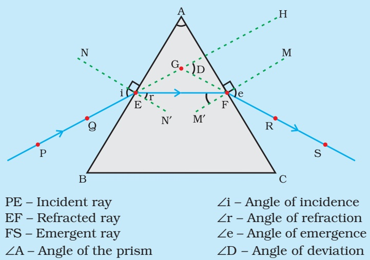

Figure 10.4 Refraction of light through a triangular glass prism

**Here PE is the incident ray, EF is the refracted ray and FS is the emergent ray. You may note that a ray of light is entering from air to glass at the first surface AB. The light ray on refraction has bent towards the normal. At the second surface AC, the light ray has entered from glass to air. Hence it has bent away from normal. Compare the angle of incidence and the angle of refraction at each refracting surface of the prism. Is this similar to the kind of bending that occurs in a glass slab? The peculiar shape of the prism makes the emergent ray bend at an angle to the direction of the incident ray. This angle is called the angle of deviation. In this case** ∠**D is the angle of deviation. Mark the angle of deviation in the above activity and measure it.**

## 10.4 DISPERSION OF WHITE LIGHT BY A GLASS PRISM

**You must have seen and appreciated the spectacular colours in a rainbow. How could the white light of the Sun give us various colours of the rainbow? Before we take up this question, we shall first go back to the refraction of light through a prism. The inclined refracting surfaces of a glass prism show exciting phenomenon. Let us find it out through an activity.**

## Activity 10.2

**Take a thick sheet of cardboard and make a small hole or narrow slit in its middle.**

**Allow sunlight to fall on the narrow slit. This gives a narrow beam of white light.**

**Now, take a glass prism and allow the light from the slit to fall on one of its faces as shown in Fig. 10.5.**

**Turn the prism slowly until the light that comes out of it appears on a nearby screen.**

**What do you observe? You will find a beautiful band of colours. Why does this happen?**