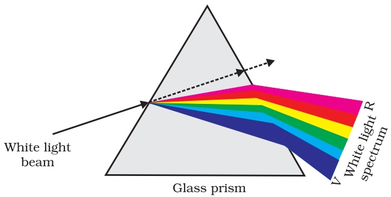
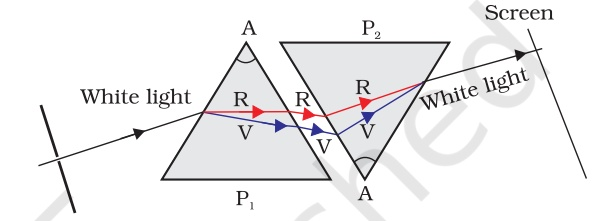
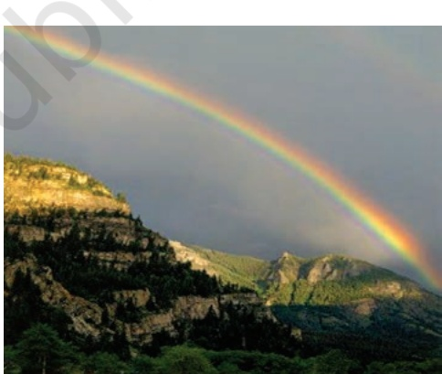
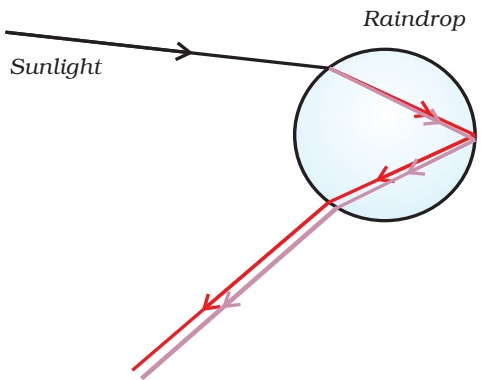

**The prism has probably split the incident white light into a band of colours. Note the colours that appear at the two ends of the colour band. What is the sequence of colours that you see on the screen? The various colours seen are Violet, Indigo, Blue, Green, Yellow, Orange and Red, as shown in Fig. 10.5. The acronym VIBGYOR will help you to remember the sequence of colours. The band of the coloured components of a light beam is called its spectrum. You might not be able to see all the colours separately.**

Figure 10.5 Dispersion of white light by the glass prism

**Yet something makes each colour distinct from the other. The splitting of light into its component colours is called dispersion.**

**You have seen that white light is dispersed into its seven-colour components by a prism. Why do we get these colours? Different colours of light bend through different angles with respect to the incident ray, as they pass through a prism. The red light bends the least while the violet the most. Thus the rays of each colour emerge along different paths and thus become distinct. It is the band of distinct colours that we see in a spectrum.**

Figure 10.6 Recombination of the spectrum of white light

**Isaac Newton was the first to use a glass prism to obtain the spectrum of sunlight. He tried to split the colours of the spectrum of white light further by using another similar prism. However, he could not get any more colours. He then placed a second identical prism in an inverted position with respect to the first prism, as shown in Fig. 10.6. This allowed all the colours of the spectrum to pass through the second prism. He found a beam of white light emerging from the other side of the second prism. This observation gave Newton the idea that the sunlight is made up of seven colours.**

**Any light that gives a spectrum similar to that of sunlight is often referred to as white light.**

**A rainbow is a natural spectrum appearing in the sky after a rain shower (Fig. 10.7). It is caused by dispersion of sunlight by tiny water droplets, present in the atmosphere. A rainbow is always formed in a direction opposite to that of the Sun. The water droplets act like small prisms. They refract and disperse the incident sunlight, then reflect it internally, and finally refract it again when it comes out of the raindrop (Fig. 10.8). Due to the dispersion of light and internal reflection, different colours reach the observer’s eye.**

**You can also see a rainbow on a sunny day when you look at the sky through a waterfall or through a water fountain, with the Sun behind you.**

Figure 10.7 Rainbow in the sky

Figure 10.8 Rainbow formation