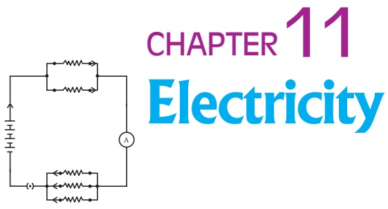

E **lectricity has an important place in modern society. It is a controllable and convenient form of energy for a variety of uses in homes, schools, hospitals, industries and so on. What constitutes electricity? How does it flow in an electric circuit? What are the factors that control or regulate the current through an electric circuit? In this Chapter, we shall attempt to answer such questions. We shall also discuss the heating effect of electric current and its applications.**

## 11.1 ELECTRIC CURRENT AND CIRCUIT

**We are familiar with air current and water current. We know that flowing water constitute water current in rivers. Similarly, if the electric charge flows through a conductor (for example, through a metallic wire), we say that there is an electric current in the conductor. In a torch, we know that the cells (or a battery, when placed in proper order) provide flow of charges or an electric current through the torch bulb to glow. We have also seen that the torch gives light only when its switch is on. What does a switch do? A switch makes a conducting link between the cell and the bulb. A continuous and closed path of an electric current is called an electric circuit. Now, if the circuit is broken anywhere (or the switch of the torch is turned off), the current stops flowing and the bulb does not glow.**

**How do we express electric current? Electric current is expressed by the amount of charge flowing through a particular area in unit time. In other words, it is the rate of flow of electric charges. In circuits using metallic wires, electrons constitute the flow of charges. However, electrons were not known at the time when the phenomenon of electricity was first observed. So, electric current was considered to be the flow of positive charges and the direction of flow of positive charges was taken to be the direction of electric current. Conventionally, in an electric circuit the direction of electric current is taken as opposite to the direction of the flow of electrons, which are negative charges.**