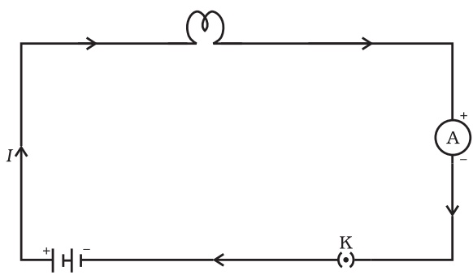

**If a net charge Q, flows across any cross-section of a conductor in time t, then the current I, through the cross-section is**

$$
I = \frac { Q } { t }\tag{11.1}
$$

**The SI unit of electric charge is coulomb (C), which is equivalent to the charge contained in nearly** $6 \times 1 0 ^ { 1 8 }$ **electrons. (We know that an electron possesses a negative charge of** $1 . 6   \times   1 0 ^ { - 1 9 }   \mathrm { C } . )$ **The electric current is expressed by a unit called ampere (A), named after the French scientist, Andre-Marie Ampere (1775–1836). One ampere is constituted by the flow of one coulomb of charge per second, that is,** $1   \mathrm { A }   =   1   \mathrm { C } / 1$ **s. Small quantities of current are expressed in milliampere**

Figure 11.1

A schematic diagram of an electric circuit comprising – cell, electric bulb, ammeter and plug key

(1 $\mathrm { m A } = 1 0 ^ { - 3 }   \mathrm { A } )$ or in microampere (1 $\mu \mathrm{A} = 10^{-6}   \mathrm{A}$ **An instrument called ammeter measures electric current in a circuit. It is always connected in series in a circuit through which the current is to be measured. Figure 11.1 shows the schematic diagram of a typical electric circuit comprising a cell, an electric bulb, an ammeter and a plug key. Note that the electric current flows in the circuit from the positive terminal of the cell to the negative terminal of the cell through the bulb and ammeter.**

## Example 11.1

**A current of 0.5 A is drawn by a filament of an electric bulb for 10 minutes. Find the amount of electric charge that flows through the circuit.**

## Solution

**We are given, I = 0.5 A; t = 10 min = 600 s.**

**From Eq. (11.1), we have**

$$
\begin{array}{l}Q_{ 氵 } \stackrel{ 氵 }{=} I t \\\stackrel{ 氵 }{=} 0.5  A  \times 600  s  \\\stackrel{ 氵 }{=} 300  C \end{array}
$$

## Q U E S T I O N S

**1. What does an electric circuit mean?**

**2. Define the unit of current.**

**3. Calculate the number of electrons constituting one coulomb of charge.**

