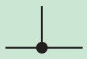
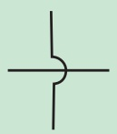

| Q U E S T I O N S |
| --- |
| 23.. WiH6soh V 1wa V bt ma? istut mcehreya? ennter bgyy s iasy ginivgen th taot e thaech po ctoeunltoimalb di offfe crhenarcgee b peatwsseienng t twhoro puogihnt as ? 1. Name a device that helps to maintain a potential difference across a conductor. |

## 11.3 CIRCUIT DIAGRAM

**We know that an electric circuit, as shown in Fig. 11.1, comprises a cell (or a battery), a plug key, electrical component(s), and connecting wires. It is often convenient to draw a schematic diagram, in which different components of the circuit are represented by the symbols conveniently used. Conventional symbols used to represent some of the most commonly used electrical components are given in Table 11.1.**

Table 11.1 Symbols of some commonly used components in circuit diagrams

<table><tr><td>S1.No.</td><td>Components</td><td rowspan=2>Symbols</td></tr><tr><td>1</td><td>An electric cell</td></tr><tr><td>2</td><td>A battery or a combination of cells</td><td>工工T</td></tr><tr><td>3</td><td>Plug key or switch (open)</td><td>—( )</td></tr><tr><td>4</td><td>Plug key or switch (closed)</td><td>—(•)</td></tr><tr><td>5</td><td>A wire joint</td><td></td></tr><tr><td>6</td><td>Wires crossing without joining</td><td></td></tr></table>