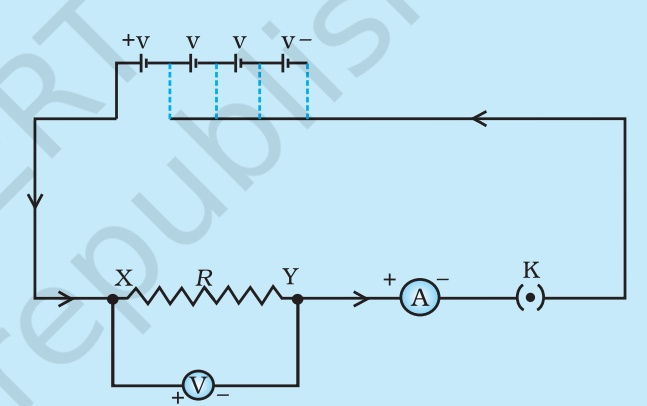

| 7 | Electric bulb | or |
| --- | --- | --- |
| 8 | A resistor of resistance R |  |
| 9 | Variable resistance or rheostat | or |
| 10 | Ammeter |  |
| 11 | Voltmeter |  |

## 11.4 OHM’S LAW

**Is there a relationship between the potential difference across a conductor and the current through it? Let us explore with an Activity.**

## Activity 11.1

**Set up a circuit as shown in Fig. 11.2, consisting of a nichrome wire XY of length, say 0.5 m, an ammeter, a voltmeter and four cells of 1.5 V each. (Nichrome is an alloy of nickel, chromium, manganese, and iron metals.)**

**First use only one cell as the source in the circuit. Note the reading in the ammeter I, for the current and reading of the voltmeter V for the potential difference across the nichrome wire XY in the circuit. Tabulate them in the Table given.**

Figure 11.2 Electric circuit for studying Ohm’s law

n **Next connect two cells in the circuit and** **note the respective readings of the ammeter and voltmeter for the values of current through the nichrome wire and potential difference across the nichrome wire.**

n **Repeat the above steps using three cells and then four cells in the circuit separately.**

n **Calculate the ratio of V to I for each pair of potential difference V and current I.**

| S. No. | Number of cells used in the circuit (ampere) | Current through the nichrome wire, I wire, V (volt) | Potential difference across the nichrome | V/I(volt/ampere) |
| --- | --- | --- | --- | --- |
| 1 | 1 |  |  |  |
| 2 | 2 |  |  |  |
| 3 | 3 |  |  |  |
| 4 | 4 |  |  |  |

n Plot a graph between V and I, and observe the nature of the graph.