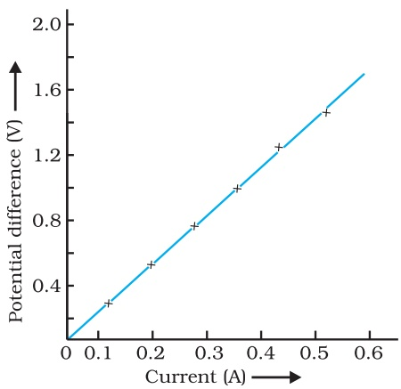

Figure 11.3

**In this Activity, you will find that approximately the same value for V/I is obtained in each case. Thus the V–I graph is a straight line that passes through the origin of the graph, as shown in Fig. 11.3. Thus, V/I is a constant ratio.**

**In 1827, a German physicist Georg Simon Ohm (1787–1854) found out the relationship between the current I, flowing in a metallic wire and the potential difference across its terminals. The potential difference, V, across the ends of a given metallic wire in an electric circuit is directly proportional to the current flowing through it, provided its temperature remains the same. This is called Ohm’s law. In other words –**

V–I graph for a nichrome wire. A straight line plot shows that as the current through a wire increases, the potential difference across the wire increases linearly – this is Ohm’s law.

$$
\begin{array} { r l r l } & { \mathrm { ~ \textit ~ { ~ V \times I ~ } ~ } } & { } & { { } } \\ & { \mathrm { ~ o r ~ \qquad } } & { \mathrm { ~ V / I ~ } = } & { { } \mathrm { ~ c o n s t a n t } } \\ & { } & { \mathrm { ~ \textit ~ { ~ F ~ } ~ } = } & { { } \mathrm { ~ \textit ~ { ~ R ~ } ~ } } \\ & { \mathrm { ~ o r ~ \qquad } } & { \mathrm { ~ V ~ } = } & { { } \mathrm { ~ \textit ~ { I   R ~ } ~ } } \end{array}\tag{11.4}
$$

**(11.5)**

**In Eq. (11.4), R is a constant for the given metallic wire at a given temperature and is called its resistance. It is the property of a conductor to resist the flow of charges through it. Its SI unit is ohm, represented by the Greek letter** Ω**. According to Ohm’s law,**

$$
R = V / I\tag{11.6}
$$

**If the potential difference across the two ends of a conductor is 1 V and the current through it is 1 A, then the resistance R, of the conductor**

**is 1** Ω. That is, $\mathrm{ohm} = \frac{1 \mathrm{volt}}{1 \mathrm{upper}}$

**Also from Eq. (11.5) we get**

$$
I \in V / R\tag{11.7}
$$

**It is obvious from Eq. (11.7) that the current through a resistor is inversely proportional to its resistance. If the resistance is doubled the current gets halved. In many practical cases it is necessary to increase or decrease the current in an electric circuit. A component used to regulate current without changing the voltage source is called variable resistance. In an electric circuit, a device called rheostat is often used to change the resistance in the circuit. We will now study about electrical resistance of a conductor with the help of following Activity.**

## Activity 11.2

**Take a nichrome wire, a torch bulb, a 10 W bulb and an ammeter (0 – 5 A range), a plug key and some connecting wires.**

**Set up the circuit by connecting four dry cells of 1.5 V each in series with the ammeter leaving a gap XY in the circuit, as shown in Fig. 11.4.**