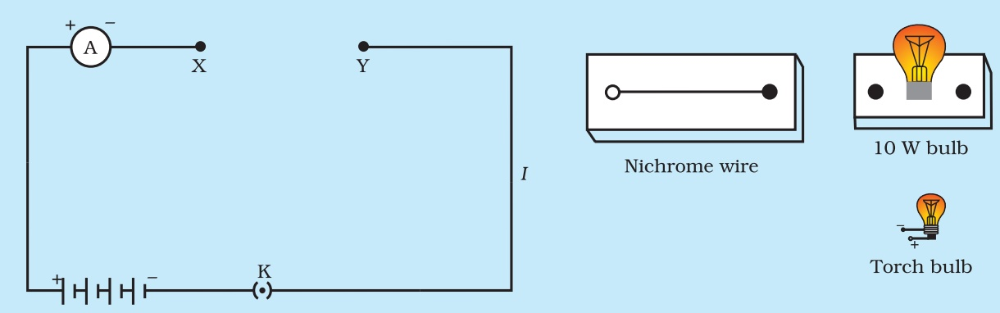

Figure 11.4

**Complete the circuit by connecting the nichrome wire in the gap XY. Plug the key. Note down the ammeter reading. Take out the key from the plug. [Note: Always take out the key from the plug after measuring the current through the circuit.]**

**Replace the nichrome wire with the torch bulb in the circuit and find the current through it by measuring the reading of the ammeter.**

n **Now repeat the above step with the 10 W bulb in the gap XY.**

**Are the ammeter readings different for different components connected in the gap XY? What do the above observations indicate?**

**You may repeat this Activity by keeping any material component in the gap. Observe the ammeter readings in each case. Analyse the observations.**

**In this Activity we observe that the current is different for different components. Why do they differ? Certain components offer an easy path for the flow of electric current while the others resist the flow. We know that motion of electrons in an electric circuit constitutes an electric current. The electrons, however, are not completely free to move within a conductor. They are restrained by the attraction of the atoms among which they move. Thus, motion of electrons through a conductor is retarded by its resistance. A component of a given size that offers a low resistance is a good conductor. A conductor having some appreciable resistance is called a resistor. A component of identical size that offers a higher resistance is a poor conductor. An insulator of the same size offers even higher resistance.**

## 11.5 FA  FACTORS ON WHICH THE RESISTANCE OF A CONDUCTOR DEPENDS

## Activity 11.3

**Complete an electric circuit consisting of a cell, an ammeter, a nichrome wire of length l [say, marked (1)] and a plug key, as shown in Fig. 11.5.**