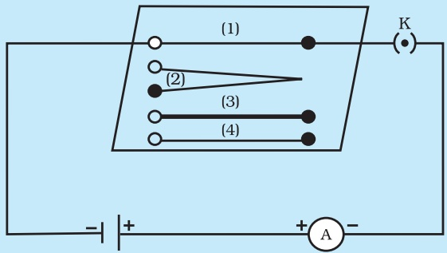

Figure 11.5 Electric circuit to study the factors on which the resistance of conducting wires depends

n **Now, plug the key. Note the current in the ammeter.**

**Replace the nichrome wire by another nichrome wire of same thickness but twice the length, that is 2l [marked (2) in the Fig. 11.5].**

n **Note the ammeter reading.**

**Now replace the wire by a thicker nichrome wire, of the same length l [marked (3)]. A thicker wire has a larger cross-sectional area. Again note down the current through the circuit.**

**Instead of taking a nichrome wire, connect a copper wire [marked (4) in Fig. 11.5] in the circuit. Let the wire be of the same length and same area of cross-section as that of the first nichrome wire [marked (1)]. Note the value of the current.**

n **Notice the difference in the current in all cases.**

n **Does the current depend on the length of the conductor?**

n **Does the current depend on the area of cross-section of the wire used?**

**It is observed that the ammeter reading decreases to one-half when the length of the wire is doubled. The ammeter reading is increased when a thicker wire of the same material and of the same length is used in the circuit. A change in ammeter reading is observed when a wire of different material of the same length and the same area of cross-section is used. On applying Ohm’s law [Eqs. (11.5) – (11.7)], we observe that the resistance of the conductor depends (i) on its length, (ii) on its area of cross-section, and (iii) on the nature of its material. Precise measurements have shown that resistance of a uniform metallic conductor is directly proportional to its length (l) and inversely proportional to the area of cross-section (A). That is,**

$$
\begin{array} { l } { { R \propto \mathcal { l } } } \\ { { R \propto 1 / A } } \end{array}
$$

**and**

**(11.8)**

**(11.9)**

**Combining Eqs. (11.8) and (11.9) we get**

$$
R \propto \frac { l } { A }
$$

**or,**

$$
R = \wp \frac { l } { A } .\tag{11.10}
$$

**where** ρ **(rho) is a constant of proportionality and is called the electrical resistivity of the material of the conductor. The SI unit of resistivity is** $\Omega$ **m. It is a characteristic property of the material. The metals and alloys**