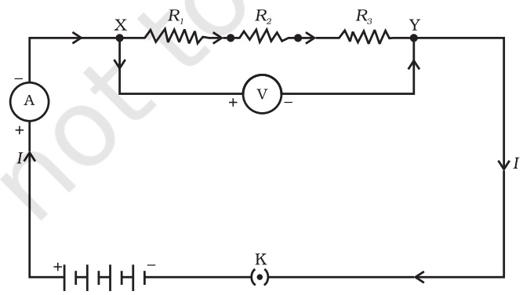

# Q U E S T I O N S

**1. On what factors does the resistance of a conductor depend?**

**2. Will current flow more easily through a thick wire or a thin wire of the same material, when connected to the same source? Why?**

**3. Let the resistance of an electrical component remains constant while the potential difference across the two ends of the component decreases to half of its former value. What change will occur in the current through it?**

**4. Why are coils of electric toasters and electric irons made of an alloy rather than a pure metal?**

**5. Use the data in Table 11.2 to answer the following –**

**(a) Which among iron and mercury is a better conductor?**

**(b) Which material is the best conductor?**

## 11.6 RESISTANCE OF A SYSTEM OF RESISTORS

**In preceding sections, we learnt about some simple electric circuits. We have noticed how the current through a conductor depends upon its resistance and the potential difference across its ends. In various electrical gadgets, we often use resistors in various combinations. We now therefore intend to see how Ohm’s law can be applied to combinations of resistors.**

**There are two methods of joining the resistors together. Figure 11.6** shows an electric circuit in which three resistors having resistances $R _ { _ { I } } ,$ $R _ { z }$ and $R _ { 3 ^ { \circ } }$ respectively, are joined end to end. Here the resistors are said **to be connected in series.**

Figure 11.6 Resistors in series