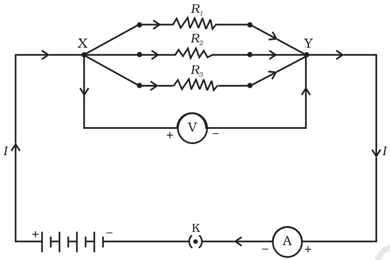

**Figure 11.7 shows a combination of resistors in which three resistors are connected together between points X and Y. Here, the resistors are said to be connected in parallel.**

Figure 11.7 Resistors in parallel

## 11.6.1 Resistors in Series

**What happens to the value of current when a number of resistors are connected in series in a circuit? What would be their equivalent resistance? Let us try to understand these with the help of the following activities.**

## Activity 11.4

**Join three resistors of different values in series. Connect them with a battery, an ammeter and a plug key, as shown in Fig. 11.6. You may use the resistors of values like 1** Ω**, 2** Ω**, 3** Ω **etc., and a battery of 6 V for performing this Activity.**

**Plug the key. Note the ammeter reading.**

**Change the position of ammeter to anywhere in between the resistors. Note the ammeter reading each time.**

**Do you find any change in the value of current through the ammeter?**

**You will observe that the value of the current in the ammeter is the same, independent of its position in the electric circuit. It means that in a series combination of resistors the current is the same in every part of the circuit or the same current through each resistor.**