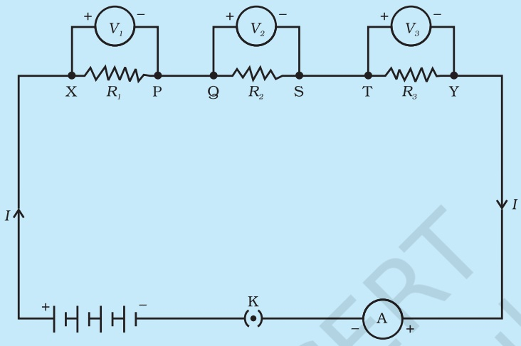

## Activity 11.5

**In Activity 11.4, insert a voltmeter across the ends X and Y of the series combination of three resistors, as shown in Fig. 11.6.**

**Plug the key in the circuit and note the voltmeter reading. It gives the potential difference across the series combination of resistors. Let it be V. Now measure the potential difference across the two terminals of the battery. Compare the two values.**

**Take out the plug key and disconnect the voltmeter. Now insert the voltmeter across the ends X and P of the first resistor, as shown in Fig. 11.8.**

Figure 11.8

**Plug the key and measure the potential difference across the first** resistor. Let it be $V _ { r }$

**Similarly, measure the potential difference across the other two** resistors, separately. Let these values be $V _ { z }$ and $V _ { 3 ^ { \prime } }$ **respectively.**

Deduce a relationship between V, $V _ { t }$ $V _ { z }$ and $V _ { 3 } .$

**You will observe that the potential difference V is equal to the sum of** potential differences $V _ { \imath } ,   V _ { \imath ^ { \prime } }$ and $V _ { s ^ { \prime } }$ **. That is the total potential difference across a combination of resistors in series is equal to the sum of potential difference across the individual resistors. That is,**

$$
V = V_{1} + V_{2} + V_{3}\tag{11.11}
$$

**In the electric circuit shown in Fig. 11.8, let I be the current through the circuit. The current through each resistor is also I. It is possible to replace the three resistors joined in series by an equivalent single resistor of resistance** $R ,$ **such that the potential difference V across it, and the current I through the circuit remains the same. Applying the Ohm’s law to the entire circuit, we have**

$$
V = I   R\tag{11.12}
$$

**Electricity**