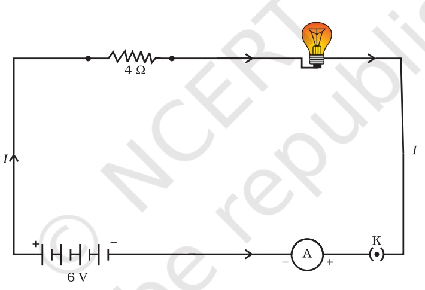

**On applying Ohm’s law to the three resistors separately, we further have**

$$
V _ { _ { \cal I } } = { \cal I }   R _ { _ { \cal I } }\tag{[11.13(a)]}
$$

$$
V _ { _ 2 } = I   R _ { _ 2 }\tag{[11.13(b)]}
$$

**and** $V _ { _ 3 } = I   R _ { _ 3 }$

**[11.13(c)]**

**From Eq. (11.11),**

$$
IR = IR_{1} + IR_{2} + IR_{3}
$$

**or**

$$
R_{s}=R_{l}+R_{2}+R_{3}\tag{11.14}
$$

**We can conclude that when several resistors are joined in series, the** resistance of the combination $R _ { s }$ **equals the sum of their individual** resistances**,** $R _ { \iota } , R _ { \iota ^ { \prime } } R _ { \substack { 3 ^ { \prime } } }$ **and is thus greater than any individual resistance.**

## Example 11.7

**An electric lamp, whose resistance is 20** Ω**, and a conductor of 4** Ω **resistance are connected to a 6 V battery (Fig. 11.9). Calculate (a) the total resistance of the circuit, (b) the current through the circuit, and (c) the potential difference across the electric lamp and conductor.**

Figure 11.9 An electric lamp connected in series with a resistor of 4 Ω to a 6 V battery

## Solution

The resistance of electric lamp, $R _ { \iota }   = 2 0 \: \Omega$

The resistance of the conductor connected in series, $R _ {   _ { 2 } }   = 4 \; \Omega .$

**Then the total resistance in the circuit**

$$
R_{ 滘 } = R_{_l} + R_{_2}
$$

$$
R_{_s} = 20 \; \Omega + 4 \; \Omega = 24 \; \Omega.
$$

**The total potential difference across the two terminals of the battery** $V   = 6 \; \mathrm { V } .$

**Now by Ohm’s law, the current through the circuit is given by**

$$
\begin{array} { r c l } { { I } } & { { = } } & { { V / R _ { \mathrm { s } } } } \\ { { } } & { { = } } & { { 6   \mathrm { V } / 2 4   \Omega } } \\ { { } } & { { = } } & { { 0 . 2 5   \mathrm { A } . } } \end{array}
$$