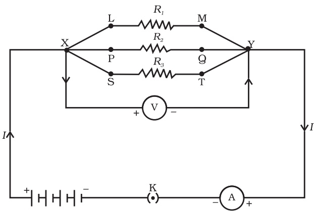

**Applying Ohm’s law to the electric lamp and conductor separately, we get potential difference across the electric lamp,**

$$
V_{_{ 丨 }} \begin{array}{l} \bar{=} 20 \Omega \times 0.25  A  ; \\ = 5  V  ; \end{array}
$$

**and,**

that across the conductor, $\begin{aligned}V_{_2} &= 4 \Omega \times 0.25  A  \\&= 1  V .\end{aligned}$

**Suppose that we like to replace the series combination of electric lamp and conductor by a single and equivalent resistor. Its resistance must be such that a potential difference of 6 V across the battery terminals will cause a current of 0.25 A in the circuit. The resistance R of this equivalent resistor would be**

**R = V/I = 6 V/ 0.25 A = 24** Ω.

**This is the total resistance of the series circuit; it is equal to the sum of the two resistances.**

## Q U E S T I O N S

**1. Draw a schematic diagram of a circuit consisting of a battery of three cells of 2 V each, a 5** Ω **resistor, an 8** Ω **resistor, and a 12** Ω **resistor, and a plug key, all connected in series.**

**2. Redraw the circuit of Question 1, putting in an ammeter to measure the current through the resistors and a voltmeter to measure the potential difference across the 12** Ω **resistor. What would be the readings in the ammeter and the voltmeter?**

## 11.6.2 Resistors in Parallel

**Now, let us consider the arrangement of three resistors joined in parallel with a combination of cells (or a battery), as shown in Fig.11.7.**

## Activity 11.6

**Make a parallel combination, XY, of three** resistors having resistances R , $R _ { 2 ^ { \prime } }$ and $R _ { 3 ^ { \prime } }$ **respectively. Connect it with a battery, a plug key and an ammeter, as shown in Fig. 11.10. Also connect a voltmeter in parallel with the combination of resistors.**

**Plug the key and note the ammeter reading. Let the current be I. Also take the voltmeter reading. It gives the potential difference V, across the combination. The potential difference across each resistor is also V. This can be checked by connecting the voltmeter across each individual resistor (see Fig. 11.11).**

Figure 11.10