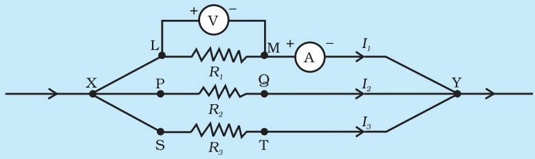

**Take out the plug from the key. Remove the ammeter and voltmeter from the circuit.** Insert the ammeter in series with the resistor $R _ { \jmath }$ **as shown in Fig. 11.11. Note the ammeter** reading, $I _ { \iota } .$

Figure 11.11

Similarly, measure the currents through $R _ { _ 2 }$ and $R _ { _ { 3 ^ { \prime } } }$ Let these be $I _ { z }$ and $I _ { \mathfrak { z } } ,$ **respectively.** What is the relationship between $I , \; I _ { 1 } , \; I _ { 2 }$ and $I _ { 3 } ?$

**It is observed that the total current I, is equal to the sum of the separate currents through each branch of the combination.**

$$
I = I_{_1} + I_{_2} + I_{_3}\tag{11.15}
$$

Let $R _ { p }$ **be the equivalent resistance of the parallel combination of resistors. By applying Ohm’s law to the parallel combination of resistors, we have**

$$
\boldsymbol { \mathit { \Pi } } = \boldsymbol { V } / R _ { p }\tag{11.16}
$$

**On applying Ohm’s law to each resistor, we have**

$$
I_{1}=V/R_{1}; \quad I_{2}=V/R_{2}; \quad  and   I_{3}=V/R_{3}\tag{11.17}
$$

**From Eqs. (11.15) to (11.17), we have**

$$
V/R_{p}=V/R_{1}+V/R_{2}+V/R_{3}
$$

**or**

$$
1 / R_{p}=1 / R_{l}+1 / R_{2}+1 / R_{3}\tag{11.18}
$$

**Thus, we may conclude that the reciprocal of the equivalent resistance of a group of resistances joined in parallel is equal to the sum of the reciprocals of the individual resistances.**

## Example 11.8

In the circuit diagram given in Fig. 11.10, suppose the resistors $R _ { _ I } ,$ $R _ { 2 }$ and $R _ { 3 }$ **have the values 5** Ω**, 10** Ω**, 30** Ω**, respectively, which have been connected to a battery of 12 V. Calculate (a) the current through each resistor, (b) the total current in the circuit, and (c) the total circuit resistance.**

## Solution

$$
R_{1}=5\ \Omega, R_{2}=10\ \Omega, \mathrm{and} R_{3}=30\ \Omega.
$$

Potential difference across the battery, $V   = 1 2   \mathrm { V } .$

**This is also the potential difference across each of the individual resistor; therefore, to calculate the current in the resistors, we use Ohm’s law.**

**The current** $I_{l}, \mathrm{through} R_{l} = \mathrm{V/R}_{l}$ **I** = 12 V/5 Ω = **2.4 A.**