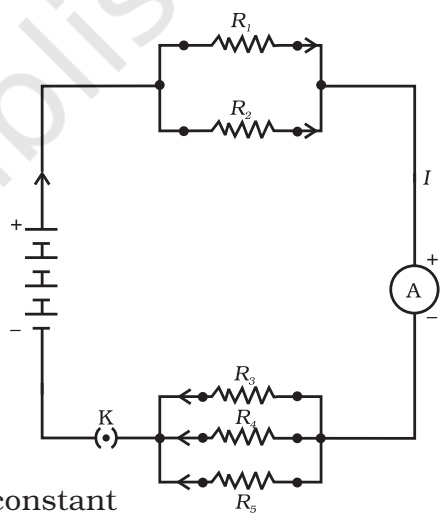

The current $I_{2}, \mathrm{through} R_{2} = V/R_{2}$

$$
I_{_2} = 12\  V  / 10\ \Omega = 1.2\  A .
$$

The current $I_{3}, \mathrm{through} R_{3} = V/R_{3}$

$$
I_{3} = 12\  V  / 30\ \Omega = 0.4\  A .
$$

**The total current in the circuit,**

$$
\begin{array} { l } { { I \quad = \quad I _ { _ { 1 } } + I _ { _ { 2 } } + I _ { _ { 3 } } } } \\ { { \quad = \quad \left( 2 . 4 + 1 . 2 + 0 . 4 \right) \mathrm { A } } } \\ { { \quad = \quad 4 \mathrm { ~ A } } } \end{array}
$$

The total resistance $R _ { p ^ { \prime } }$ **is given by [Eq. (11.18)]**

$$
\left[ \frac{1}{R_{p}} = \frac{1}{5} + \frac{1}{10} + \frac{1}{30} = \frac{1}{3} \right.
$$

Thus, $R _ { _ { p } } = 3 \; \Omega .$

## Example 11.9

If in Fig. 11.12, $R_{1}=10\Omega,R_{2}=40\Omega,R_{3}=30\Omega,R_{4}=20\Omega,R_{5}=60\Omega,$ **and a 12 V battery is connected to the arrangement. Calculate (a) the total resistance in the circuit, and (b) the total current flowing in the circuit.**

## Solution

Suppose we replace the parallel resistors $R _ { I }$ and $R _ { z }$ **by an equivalent resistor of resistance,** $R ^ { \prime }$ **Similarly we replace** the parallel resistors $R _ { _ 3 } , R _ { _ 4 }$ and $R _ { \bar { 5 } }$ **by an equivalent single resistor of resistance** $\dot { R ^ { \prime } } ,$ **Then using Eq. (11.18), we have** $1 / R^{\prime} = 1 / 10 + 1 / 40 = 5 / 40;$ that is $R ^ { \prime } = 8 \; \Omega$ **Similarly,** $1/R'' \quad = \quad 1/30 \pm 1/20 + 1/60 = 6/60;$ that is, $R ^ { \prime \prime } \equiv 1 0 \; \Omega .$ Thus, the total resistance, $R = R' + R'' = 18 \Omega.$ **To calculate the current, we use Ohm’s law, and get** $I = V / R = 12\  V  / 18\ \Omega = 0.67\  A .$

**We have seen that in a series circuit the current is constant throughout the electric circuit. Thus it is obviously impracticable to connect an electric bulb and an electric heater in series, because they need currents of widely different values to operate properly (see Example 11.3). Another major disadvantage of a series circuit is that when one component fails the circuit is broken and none of the components works. If you have used ‘fairy lights’ to decorate buildings on festivals, on marriage celebrations etc., you might have seen the electrician spending lot of time in trouble-locating and replacing the ‘dead’ bulb – each has to be tested to find which has fused or gone. On the other hand, a parallel circuit divides the current through the electrical gadgets. The total resistance in a parallel circuit is decreased as per Eq. (11.18). This is helpful particularly when each gadget has different resistance and requires different current to operate properly.**

Figure 11.12 An electric circuit showing the combination of series and parallel resistors